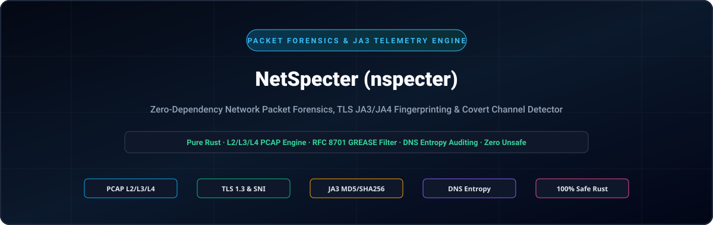
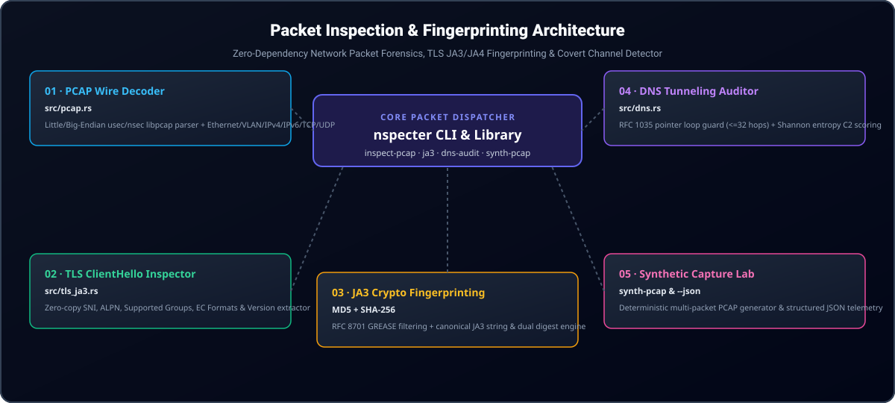

<div align="center">

<p align="center">
  <strong>🇺🇸 English</strong> · <a href="./docs/locales/ko.md">🇰🇷 한국어</a> · <a href="./docs/locales/zh-CN.md">🇨🇳 中文</a> · <a href="./docs/locales/es.md">🇪🇸 Español</a> · <a href="./docs/locales/hi.md">🇮🇳 हिन्दी</a><br />
  <a href="./docs/locales/ar.md">🇸🇦 العربية</a> · <a href="./docs/locales/pt-BR.md">🇧🇷 Português</a> · <a href="./docs/locales/ru.md">🇷🇺 Русский</a> · <a href="./docs/locales/fr.md">🇫🇷 Français</a> · <a href="./docs/locales/id.md">🇮🇩 Bahasa Indonesia</a>
</p>

<p align="center">
  
</p>

# NetSpecter (nspecter)

**Zero-Dependency Network Packet Forensics, TLS JA3/JA4 Fingerprinting & Covert Channel Detector**

[](https://github.com/GHSFS/net-specter/actions/workflows/ci.yml)
[](./LICENSE)
[](./Cargo.toml)
[](./SECURITY.md)

---

## 🛡️ Overview & Core Capabilities

<details open>
<summary><b>🛡️ Overview & Core Capabilities</b></summary>
<br>

net-specter (nspecter) is a fast, memory-safe command-line utility and Rust library for offline network packet forensics, cryptographic handshake fingerprinting, and covert-tunneling detection without libpcap or C bindings.

1. **Zero-Dependency PCAP & PCAPNG Capture Engine (`src/pcap.rs` & `src/pcapng.rs`)** — Decodes classic libpcap `.pcap` files across both little-endian and big-endian microsecond/nanosecond headers (`0xA1B2C3D4`, `0xA1B23C4D`), Ethernet II frames (with IEEE 802.1Q VLAN tag unwrapping), Raw IP captures (`linktype 101`), IPv4/IPv6 headers, and TCP/UDP transport segments, as well as next-generation `.pcapng` Section Header Blocks (`0x0A0D0D0A`), Interface Description Blocks, Enhanced Packet Blocks, and Simple Packet Blocks with arbitrary timestamp resolution.
2. **TLS `ClientHello` Deep Inspector & JA3 Engine (`src/tls_ja3.rs`)** — Parses TLS Handshake (`0x16`) `ClientHello` (`0x01`) records, extracts SNI hostnames (`0x0000`), Supported Groups (`0x000a`), EC Point Formats (`0x000b`), ALPN protocols (`0x0010`), and Supported Versions (`0x002b`), filters RFC 8701 GREASE values (`0x?a?a`), and computes both **JA3 MD5** and **SHA-256** fingerprints.
3. **DNS Wire-Format Parser & Covert Tunneling Auditor (`src/dns.rs`)** — Decodes RFC 1035 DNS packets with strict compression pointer loop protection (`<= 32` hops) and scores subdomain Shannon entropy, label lengths, and hexadecimal/Base32 payload density to flag covert C2 or data exfiltration channels (`Low`, `Elevated`, `High`).
4. **Deterministic Capture Synthesis (`nspecter synth-pcap`)** — Generates self-contained multi-packet `.pcap` and `.pcapng` captures containing TLS 1.3 `ClientHello` and benign/covert DNS queries for reproducible CI testing and analyst validation.
5. **JA4 & JA4S Modern TLS / QUIC Fingerprinting Engine (`src/ja4.rs`)** — Computes FoxIO-compatible sorted JA4 client fingerprints (`t13d1516h2_<cipher_hash>_<ext_hash>`) and JA4S server response fingerprints resilient to TLS extension order randomization across TCP, QUIC, and DTLS transports.
6. **TCP Stream Reassembly & Out-of-Order Segment Tracker (`src/tcp_stream.rs`)** — Reconstructs bidirectional TCP byte streams across fragmented, retransmitted, and out-of-order segments with RFC 793 32-bit sequence wrap-around, DoS memory limits, and multi-segment application protocol inspection (TLS JA3/JA4, HTTP/1.1, HTTP/2, SSH).
7. **HTTP/1.1 & HTTP/2 Frame Inspector & JA4H Fingerprinting (`src/http_inspect.rs`)** — Parses HTTP/1.1 requests and responses, decodes HTTP/2 connection prefaces, binary frame streams, and `SETTINGS` parameters, and computes FoxIO-compliant `JA4H` client fingerprints (`nspecter http-audit`).
8. **TLS ServerHello JA3S & X.509 Certificate Chain Forensics (`src/tls_cert.rs`)** — Extracts JA3S server response fingerprints (MD5 and SHA-256 with RFC 8701 GREASE immunity), decodes TLS 1.2 and TLS 1.3 `Certificate` (`0x0b`) messages, provides a zero-dependency ASN.1 DER parser for X.509 certificates (Subject/Issuer DN, validity timestamps, DNS/IP SANs, serial numbers, signature algorithms), and flags certificate anomalies (expired, not yet valid, inverted validity, weak signature algorithms, self-signed) across PCAP, PCAPNG, and reassembled TCP streams (`nspecter cert-audit`).
9. **QUIC Initial Packet & RFC 9001 Decryptor (`src/quic.rs`, `src/quic_crypto.rs`)** — Derives initial keys via HKDF-SHA256, unmasks RFC 9001 header protection, decrypts QUIC Initial packets with pure Rust AES-128-GCM, reassembles CRYPTO frames, and extracts TLS 1.3 JA3/JA4 fingerprints over UDP/443 (`nspecter quic-audit`).
10. **C2 Beacon Jitter & Periodic Interval Spectrogram Detector (`src/beacon.rs`)** — Analyzes flow inter-arrival deltas ($Delta t$), mean/variance/median jitter, coefficient of variation ($CV$), interval frequency spectrograms, and periodicity scores to classify automated C2 heartbeats (`HighConfidenceBeacon`, `JitteredBeacon`, `SuspectInterval`, `Benign`) across PCAP and PCAPNG captures (`nspecter beacon-audit`).

</details>

---

## 🏛️ Packet Inspection & Fingerprinting Architecture

<details open>
<summary><b>🏛️ Packet Inspection & Fingerprinting Architecture</b></summary>
<br>

<p align="center">
  
</p>

| # | Component | Module | Responsibility |
|---|---|---|---|
| **01** | **01 · PCAP Wire Decoder** | `src/pcap.rs` | Little/Big-Endian usec/nsec libpcap parser + Ethernet/VLAN/IPv4/IPv6/TCP/UDP |
| **02** | **02 · TLS ClientHello Inspector** | `src/tls_ja3.rs` | Zero-copy SNI, ALPN, Supported Groups, EC Formats & Version extractor |
| **03** | **03 · JA3 Crypto Fingerprinting** | `MD5 + SHA-256` | RFC 8701 GREASE filtering + canonical JA3 string & dual digest engine |
| **04** | **04 · DNS Tunneling Auditor** | `src/dns.rs` | RFC 1035 pointer loop guard (<=32 hops) + Shannon entropy C2 scoring |
| **05** | **05 · Synthetic Capture Lab** | `synth-pcap & --json` | Deterministic multi-packet PCAP generator & structured JSON telemetry |

</details>

---

## 🚀 Quick Start & CLI Usage

<details open>
<summary><b>🚀 Quick Start & CLI Usage</b></summary>
<br>

```bash
# 1. Build the release binary
cargo build --release

# 2. Generate a deterministic sample .pcap or .pcapng capture (TLS 1.3 ClientHello + DNS packets)
./target/release/nspecter synth-pcap sample.pcap
./target/release/nspecter synth-pcap sample.pcapng --pcapng

# 3. Inspect all flows, TLS JA3 handshakes, and DNS queries in a capture (.pcap or .pcapng)
./target/release/nspecter inspect-pcap sample.pcap
./target/release/nspecter inspect-pcap sample.pcapng --json

# 4. Extract TLS ClientHello details and JA3 MD5 / SHA-256 digests from a capture or hex string
./target/release/nspecter ja3 sample.pcapng --json

# 5. Extract FoxIO JA4 client and JA4S server fingerprints from a capture or hex string
./target/release/nspecter ja4 sample.pcapng --json

# 6. Audit DNS packets for high-entropy covert tunneling / C2 exfiltration
./target/release/nspecter dns-audit sample.pcapng --json

# 7. Reassemble bidirectional TCP streams and inspect application payloads
./target/release/nspecter tcp-stream sample.pcapng --json

# 8. Inspect HTTP/1.1 & HTTP/2 frames and compute JA4H HTTP client fingerprints
./target/release/nspecter http-audit capture.pcap --json

# 9. Forensically audit TLS ServerHello JA3S fingerprints and X.509 certificate chains
./target/release/nspecter cert-audit capture.pcap --json

# 10. Decrypt QUIC Initial packets and extract TLS 1.3 JA3/JA4 fingerprints
./target/release/nspecter quic-audit capture.pcap --json

# 11. Audit C2 beacon jitter and periodic interval spectrograms
./target/release/nspecter beacon-audit capture.pcap --min-events 4 --json
```

</details>

---

## 📦 Module & Subcommand Reference

<details open>
<summary><b>📦 Module & Subcommand Reference</b></summary>
<br>

```text
net-specter/
├── Cargo.toml                     # Crate manifest (net-specter / nspecter binary)
├── README.md                      # Primary English documentation
├── ROADMAP.md                     # Shipped capabilities & upcoming milestones
├── CHANGELOG.md                   # Release history
├── SECURITY.md                    # Memory safety & parser security policy
├── LICENSE                        # Apache-2.0 License
├── NOTICE                         # Attribution notice (GHSFS)
├── src/
│   ├── lib.rs                     # Public library exports
│   ├── main.rs                    # CLI entrypoint & output formatter
│   ├── cli.rs                     # Clap subcommand definitions
│   ├── error.rs                   # Unified SpecterError & Result<T>
│   ├── beacon.rs                  # C2 beacon jitter & interval spectrogram detector
│   ├── pcap.rs                    # Libpcap .pcap decoder, L2/L3/L4 parser & generator
│   ├── pcapng.rs                  # PCAPNG block parser (SHB/IDB/EPB/SPB) & generator
│   ├── quic.rs                    # QUIC Initial packet & CRYPTO stream extractor
│   ├── quic_crypto.rs             # Pure Rust HKDF-SHA256, AES-128 & GCM decryptor
│   ├── tls_ja3.rs                 # TLS ClientHello parser, GREASE filter & JA3 engine
│   ├── tls_cert.rs                # TLS ServerHello JA3S, TLS 1.2/1.3 Certs & X.509 ASN.1 parser
│   ├── ja4.rs                     # Modern FoxIO JA4 client & JA4S server fingerprint engine
│   ├── tcp_stream.rs              # Stateful TCP stream reassembly & out-of-order tracker
│   ├── http_inspect.rs            # HTTP/1.1, HTTP/2 SETTINGS frame & JA4H fingerprint engine
│   └── dns.rs                     # RFC 1035 DNS decoder & Shannon entropy tunnel auditor
└── tests/
    ├── beacon_test.rs             # C2 beacon jitter, spectrogram & classification tests
    ├── pcap_tls_test.rs           # PCAP, L2/L3/L4, GREASE & JA3 integration tests
    ├── pcapng_test.rs             # PCAPNG blocks, nanosecond timing & CLI integration tests
    ├── ja4_test.rs                # JA4/JA4S, QUIC Initial & GREASE immunity integration tests
    ├── quic_test.rs               # RFC 9001 HKDF, AES-GCM & QUIC Initial decrypt tests
    ├── tcp_stream_test.rs         # TCP stream reassembly & multi-segment TLS tests
    ├── http_inspect_test.rs       # HTTP/1.1, HTTP/2 frames & JA4H integration tests
    ├── tls_cert_test.rs           # ServerHello JA3S, X.509 ASN.1 DER & anomaly integration tests
    └── dns_audit_test.rs          # DNS compression loop & covert tunnel integration tests
```

See [ROADMAP.md](./ROADMAP.md) for planned transport and protocol forensics capabilities.

</details>

---

## 🔒 Memory Safety & Parser Hardening

<details open>
<summary><b>🔒 Memory Safety & Parser Hardening</b></summary>
<br>

- **100% Safe Rust**: Zero `unsafe` blocks across all binary frame decoders.
- **RFC 1035 Compression Loop Defense**: DNS name decompression enforces a strict 32-hop pointer ceiling and forward/self-pointer rejection.
- **Transient Buffer Zeroization**: Ephemeral TLS random, session ID, and reassembly byte buffers are wiped on drop via `zeroize`.
- **DoS-Resistant Segment Buffering**: Out-of-order TCP segment queuing enforces bounded per-stream memory quotas to prevent memory exhaustion from fragmented segment floods.
- **Policy & Vulnerability Reporting**: Refer to [SECURITY.md](./SECURITY.md).

</details>

---

## 📄 License & Attribution

<details open>
<summary><b>📄 License & Attribution</b></summary>
<br>

```text
Copyright 2026 GHSFS

Licensed under the Apache License, Version 2.0 (the "License");
you may not use this file except in compliance with the License.
You may obtain a copy of the License at

    http://www.apache.org/licenses/LICENSE-2.0
```

</details>
