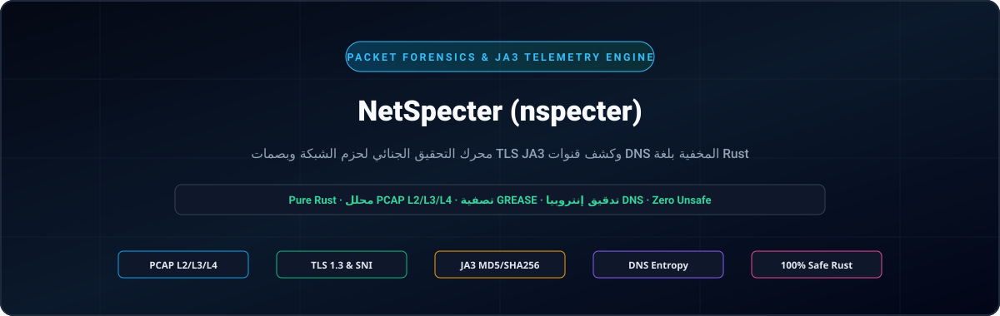
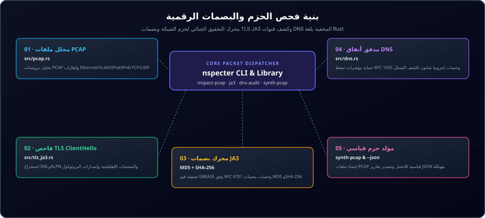

<div align="center">

<p align="center">
  <a href="../../README.md">🇺🇸 English</a> · <a href="./ko.md">🇰🇷 한국어</a> · <a href="./zh-CN.md">🇨🇳 中文</a> · <a href="./es.md">🇪🇸 Español</a> · <a href="./hi.md">🇮🇳 हिन्दी</a><br />
  <strong>🇸🇦 العربية</strong> · <a href="./pt-BR.md">🇧🇷 Português</a> · <a href="./ru.md">🇷🇺 Русский</a> · <a href="./fr.md">🇫🇷 Français</a> · <a href="./id.md">🇮🇩 Bahasa Indonesia</a>
</p>

<p align="center">
  
</p>

# NetSpecter (nspecter)

**محرك بلغة Rust الخالصة لتحليل حزم الشبكة الجنائي وبصمات TLS JA3/JA4 وكشف القنوات الخفية دون أي تبعيات خارجية لـ C**

[](https://github.com/GHSFS/net-specter/actions/workflows/ci.yml)
[](../../LICENSE)
[](../../Cargo.toml)
[](../../SECURITY.md)

</div>

---

## 🛡️ نظرة عامة والقدرات الأساسية

<details open>
<summary><b>🛡️ نظرة عامة والقدرات الأساسية</b></summary>
<br>

net-specter (nspecter) هي أداة سطر أوامر ومكتبة برمجية بلغة Rust الخالصة مصممة للتحليل الجنائي لحزم الشبكة دون اتصال، واستخراج البصمات التشفيرية للمصافحة، وكشف قنوات الاتصال الخفية دون الحاجة إلى مكتبة libpcap أو ارتباطات C الخارجية.

1. **محرك التقاط PCAP و PCAPNG بدون تبعيات (`src/pcap.rs` و `src/pcapng.rs`)** — يفك تشفير ملفات libpcap `.pcap` الكلاسيكية بتنسيقي little-endian و big-endian بدقة ميكروثانية ونانوثانية (`0xA1B2C3D4` و `0xA1B23C4D`)، وإطارات Ethernet II (مع فك وسوم VLAN IEEE 802.1Q)، وحزم Raw IP (`linktype 101`)، وترويسات IPv4/IPv6، وقطاعات نقل TCP/UDP؛ بالإضافة إلى كتل الجيل القادم `.pcapng` (SHB `0x0A0D0D0A` و IDB و EPB و SPB) بأي دقة زمنية.
2. **فاحص TLS `ClientHello` المتعمق ومحرك JA3 (`src/tls_ja3.rs`)** — يحلل سجلات مصافحة TLS (`0x16`) من نوع `ClientHello` (`0x01`)، ويستخرج أسماء مضيفي SNI (`0x0000`)، والمجموعات المدعومة (`0x000a`)، وتنسيقات نقاط المنحنيات الإهليلجية EC (`0x000b`)، وبروتوكولات ALPN (`0x0010`)، والإصدارات المدعومة (`0x002b`)؛ مع تصفية قيم GREASE وفقًا للمعيار RFC 8701 (`0x?a?a`) تلقائيًا واحتساب بصمات **JA3 MD5** و **SHA-256**.
3. **محلل تنسيق DNS السلكي ومدقق الأنفاق الخفية (`src/dns.rs`)** — يفك تشفير حزم DNS وفقًا للمعيار RFC 1035 مع حماية صارمة من حلقات مؤشرات الضغط (`<= 32` قفزة)، ويحسب إنتروبيا شانون للنطاقات الفرعية، وأطوال التسميات، وكثافة حمولة Base32/Hexadecimal لاكتشاف قنوات التحكم والسيطرة C2 أو تسريب البيانات (`Low` و `Elevated` و `High`).
4. **مختبر توليد حزم الاختبار الحتمية (`nspecter synth-pcap`)** — ينشئ ملفات التقاط `.pcap` و `.pcapng` قائمة بذاتها ومتعددة الحزم تحتوي على مصافحات TLS 1.3 `ClientHello` واستعلامات DNS سليمة وخفية لاختبارات التكامل CI والتحقق الجنائي.
5. **محرك بصمات TLS و QUIC الحديثة JA4 و JA4S (`src/ja4.rs`)** — ينتج بصمات عميل JA4 مرتبة ومتوافقة مع FoxIO (`t13d1516h2_<cipher_hash>_<ext_hash>`) وبصمات استجابة خادم JA4S محصنة ضد الترتيب العشوائي لملحقات TLS عبر بروتوكولات TCP و QUIC و DTLS.
6. **إعادة تجميع تدفقات TCP وتتبع المقاطع غير المرتبة (`src/tcp_stream.rs`)** — يعيد بناء تدفقات بايتات TCP ثنائية الاتجاه عبر الحزم المجزأة والمعاد إرسالها وغير المرتبة مع معالجة التفاف تسلسل 32 بت وفق RFC 793 وحدود ذاكرة صارمة ضد هجمات DoS وفحص عميق لبروتوكولات التطبيقات (TLS JA3/JA4 و HTTP/1.1 و HTTP/2 و SSH).
7. **فاحص إطارات HTTP/1.1 و HTTP/2 وبصمات JA4H (`src/http_inspect.rs`)** — يحلل طلبات واستجابات HTTP/1.1، ويفك تشفير مقدمة اتصال HTTP/2 وتدفقات الإطارات الثنائية ومعلمات `SETTINGS`، ويحسب بصمات عميل `JA4H` المتوافقة مع معايير FoxIO (`nspecter http-audit`).
8. **التحليل الجنائي لبصمات ServerHello JA3S وسلاسل شهادات X.509 (`src/tls_cert.rs`)** — يستخرج بصمات استجابة خادم JA3S (بترميز MD5 و SHA-256 مع حصانة ضد GREASE RFC 8701)، ويفك تشفير رسائل شهادات TLS 1.2 و TLS 1.3 `Certificate` (`0x0b`)؛ ويوفر محلل ASN.1 DER خالي من التبعيات لشهادات X.509 ويكشف شذوذ الشهادات (منتهية الصلاحية، غير صالحة بعد، تواريخ معكوسة، خوارزميات توقيع ضعيفة، موقعة ذاتيًا) (`nspecter cert-audit`).
9. **مفكك تشفير حزم QUIC الأولية وفق RFC 9001 (`src/quic.rs` و `src/quic_crypto.rs`)** — يشتق المفاتيح الأولية عبر HKDF-SHA256، ويزيل قناع حماية ترويسة RFC 9001، ويفك تشفير حزم QUIC Initial باستخدام AES-128-GCM بلغة Rust الخالصة، ويعيد تجميع إطارات CRYPTO ويستخرج بصمات TLS 1.3 JA3/JA4 عبر UDP/443 (`nspecter quic-audit`).
10. **كاشف تذبذب نبضات C2 والتحليل الطيفي الدوري (`src/beacon.rs`)** — يحلل الفوارق الزمنية لوصول الحزم ($Delta t$)، ومتوسط/تباين/وسيط التذبذب، ومعامل الاختلاف ($CV$)، والرسوم الطيفية لتردد الفترات لفرز نبضات خوادم C2 المؤتمتة (`HighConfidenceBeacon` و `JitteredBeacon` و `SuspectInterval` و `Benign`) (`nspecter beacon-audit`).
11. **محرك تقييم تعبيرات تصفية الحزم بأسلوب BPF (`src/filter/`)** — يقيّم تعبيرات التصفية مقابل نطاقات CIDR لـ IPv4/IPv6، ونطاقات المنافذ، وبروتوكولات النقل، وأقنعة علامات TCP، وأطوال الإطارات (`nspecter filter`).
12. **بصمات تبادل مفاتيح SSH HASSH للعميل والخادم (`src/ssh_hassh.rs`)** — يحلل ترويسات تعريف SSH وفق RFC 4253 وحزم `SSH_MSG_KEXINIT`، ويحسب بصمات Salesforce `HASSH` و `HASSHServer` بترميز MD5 و SHA-256 (`nspecter hassh`).

</details>

---

## 🏛️ بنية فحص الحزم واستخراج البصمات

<details open>
<summary><b>🏛️ بنية فحص الحزم واستخراج البصمات</b></summary>
<br>

<p align="center">
  
</p>

| # | المكون (Component) | الوحدة (Module) | المسؤولية الوظيفية (Responsibility) |
|---|---|---|---|
| **01** | **01 · مفكك تشفير إطارات PCAP** | `src/pcap.rs` | تحليل ملفات libpcap بدقة ميكرو/نانوثانية وفك حزم Ethernet/VLAN/IPv4/IPv6/TCP/UDP |
| **02** | **02 · فاحص TLS ClientHello** | `src/tls_ja3.rs` | استخراج بدون نسخ لـ SNI و ALPN ومجموعات المنحنيات وتنسيقات EC والإصدارات |
| **03** | **03 · بصمة التشفير JA3** | `MD5 + SHA-256` | تصفية قيم GREASE وفق RFC 8701 وتوليد نصوص JA3 القياسية والملخص المزدوج |
| **04** | **04 · مدقق أنفاق DNS** | `src/dns.rs` | حماية حلقات مؤشرات RFC 1035 (<=32 قفزة) وتقييم إنتروبيا شانون لقنوات C2 |
| **05** | **05 · مختبر توليد الحزم** | `synth-pcap & --json` | توليد حزم PCAP متعددة حتمية وإخراج قياسات هيكلية بتنسيق JSON |

</details>

---

## 🚀 البدء السريع وأوامر سطر الأوامر

<details open>
<summary><b>🚀 البدء السريع وأوامر سطر الأوامر</b></summary>
<br>

```bash
# 1. بناء النسخة المحسنة للإنتاج
cargo build --release

# 2. إنشاء ملف التقاط تجريبي حتمي بتنسيق .pcap أو .pcapng (يحتوي على TLS 1.3 ClientHello وحزم DNS)
./target/release/nspecter synth-pcap sample.pcap
./target/release/nspecter synth-pcap sample.pcapng --pcapng

# 3. فحص كافة التدفقات ومصافحات TLS JA3 واستعلامات DNS في ملف الالتقاط (.pcap أو .pcapng)
./target/release/nspecter inspect-pcap sample.pcap
./target/release/nspecter inspect-pcap sample.pcapng --json

# 4. استخراج تفاصيل TLS ClientHello وبصمات JA3 MD5 / SHA-256 من ملف التقاط أو نص ست عشري
./target/release/nspecter ja3 sample.pcapng --json

# 5. استخراج بصمات عميل FoxIO JA4 وخادم JA4S من ملف التقاط أو نص ست عشري
./target/release/nspecter ja4 sample.pcapng --json

# 6. تدقيق حزم DNS للكشف عن الأنفاق الخفية عالية الإنتروبيا وتسريب بيانات C2
./target/release/nspecter dns-audit sample.pcapng --json

# 7. إعادة تجميع تدفقات TCP ثنائية الاتجاه وفحص حمولات التطبيقات
./target/release/nspecter tcp-stream sample.pcapng --json

# 8. فحص إطارات HTTP/1.1 و HTTP/2 واحتساب بصمات عميل HTTP JA4H
./target/release/nspecter http-audit capture.pcap --json

# 9. التدقيق الجنائي لبصمات TLS ServerHello JA3S وسلاسل شهادات X.509
./target/release/nspecter cert-audit capture.pcap --json

# 10. فك تشفير حزم QUIC Initial واستخراج بصمات TLS 1.3 JA3/JA4
./target/release/nspecter quic-audit capture.pcap --json

# 11. تدقيق تذبذب نبضات C2 والرسوم الطيفية للفترات الزمنية الدورية
./target/release/nspecter beacon-audit capture.pcap --min-events 4 --json

# 12. تصفية إطارات الالتقاط باستخدام تعبيرات ترشيح بأسلوب BPF
./target/release/nspecter filter capture.pcap "tcp port 443" --json

# 13. استخراج ترويسات SSH وفك مفاوضات KEXINIT واحتساب بصمات Salesforce HASSH
./target/release/nspecter hassh capture.pcap --json

# 14. تدقيق تدفقات طلبات واستجابات ICMP Echo لاكتشاف الأنفاق وتعديل الحمولات
./target/release/nspecter icmp-tunnel capture.pcap --dump-payload --json

# 15. التعرف السلبي على أنظمة التشغيل من حزم TCP SYN (p0f v3 و FoxIO JA4T)
./target/release/nspecter os-fp capture.pcap --json

# 16. تدقيق طلبات واستجابات ARP لاكتشاف الانتحال وتدفقات البث الشاذة وهجمات MITM
./target/release/nspecter arp-audit capture.pcap --gateway 192.168.1.1 --json
```

</details>

---

## 📦 دليل الوحدات البرمجية والأوامر الفرعية

<details open>
<summary><b>📦 دليل الوحدات البرمجية والأوامر الفرعية</b></summary>
<br>

```text
net-specter/
├── Cargo.toml                     # ملف تعريف الحزمة (مكتبة net-specter وملف nspecter التنفيذي)
├── README.md                      # التوثيق الأساسي باللغة الإنجليزية
├── ROADMAP.md                     # الميزات المكتملة وخارطة الطريق المستقبلية
├── CHANGELOG.md                   # سجل الإصدارات والتحديثات
├── SECURITY.md                    # أمان الذاكرة وسياسة الإبلاغ عن الثغرات
├── LICENSE                        # رخصة Apache-2.0
├── NOTICE                         # إشعار حقوق النشر والإسناد (GHSFS)
├── src/
│   ├── lib.rs                     # واجهة المكتبة العامة
│   ├── main.rs                    # نقطة الدخول الرئيسية للـ CLI (موزع مقتضب <25 سطرًا)
│   ├── cli.rs                     # تعريفات أوامر ومعاملات Clap
│   ├── error.rs                   # نموذج الأخطاء الموحد SpecterError و Result<T>
│   ├── commands/                  # معالجات أوامر CLI المعيارية (arp, inspect, tls, dns, tcp, http, cert, quic, synth, beacon, filter, hassh, icmp, os_fp)
│   ├── filter/                    # محلل ومقيّم تعبيرات التصفية بأسلوب BPF
│   ├── arp_audit.rs               # كاشف انتحال ARP وهجمات MITM وفق RFC 826 / RFC 5227
│   ├── p0f/                       # محرك التعرف السلبي على أنظمة التشغيل وبصمات FoxIO JA4T/JA4TS
│   ├── icmp_tunnel.rs             # كاشف أنفاق ICMP Echo وتعديل الحمولات الخفية
│   ├── beacon.rs                  # كاشف تذبذب نبضات C2 والتحليل الطيفي للفترات
│   ├── pcap.rs                    # مفكك حزم Libpcap ومحلل الطبقات L2/L3/L4 ومنشئ الحزم
│   ├── pcapng.rs                  # محلل كتل PCAPNG (SHB/IDB/EPB/SPB) ومولد الإطارات
│   ├── quic.rs                    # مستخرج حزم QUIC Initial وتدفقات CRYPTO
│   ├── quic_crypto.rs             # مفكك تشفير HKDF-SHA256 و AES-128 و GCM بلغة Rust الخالصة
│   ├── ssh_hassh.rs               # ترويسات SSH-2.0 ومحرك Salesforce HASSH/HASSHServer
│   ├── tls_ja3.rs                 # محلل TLS ClientHello ومرشح GREASE ومحرك JA3
│   ├── tls_cert.rs                # محلل ServerHello JA3S وشهادات TLS 1.2/1.3 و X.509 ASN.1
│   ├── ja4.rs                     # محرك بصمات عميل FoxIO JA4 وخادم JA4S
│   ├── tcp_stream.rs              # إعادة تجميع تدفقات TCP وحفظ الحالة وتتبع الترتيب
│   ├── http_inspect.rs            # محلل إطارات HTTP/1.1 و HTTP/2 SETTINGS ومحرك بصمات JA4H
│   └── dns.rs                     # مفكك حزم DNS وفق RFC 1035 ومدقق إنتروبيا الأنفاق
└── tests/
    ├── arp_audit_test.rs          # اختبارات انتحال ARP وتذبذب البوابة والبث الشاذ
    ├── p0f_test.rs                # اختبارات التعرف السلبي على أنظمة التشغيل وبصمات FoxIO JA4T
    ├── icmp_tunnel_test.rs        # اختبارات أنفاق ICMP وإنتروبيا شانون
    ├── beacon_test.rs             # اختبارات تذبذب نبضات C2 والتحليل الطيفي والتصنيف
    ├── filter_test.rs             # اختبارات تقييم تعبيرات تصفية الحزم بأسلوب BPF
    ├── pcap_tls_test.rs           # اختبارات تكامل PCAP و L2-L4 و GREASE و JA3
    ├── pcapng_test.rs             # اختبارات كتل PCAPNG والدقة الزمنية وأوامر CLI
    ├── ja4_test.rs                # اختبارات JA4/JA4S وحزم QUIC Initial وحصانة GREASE
    ├── quic_test.rs               # اختبارات اشتقاق مفاتيح HKDF وفك تشفير AES-GCM لـ QUIC
    ├── ssh_hassh_test.rs          # اختبارات ترويسات SSH ومفاوضات KEXINIT و Salesforce HASSH
    ├── tcp_stream_test.rs         # اختبارات إعادة تجميع تدفقات TCP وحمولات TLS متعددة المقاطع
    ├── http_inspect_test.rs       # اختبارات إطارات HTTP/1.1 و HTTP/2 وبصمات JA4H
    ├── tls_cert_test.rs           # اختبارات ServerHello JA3S و X.509 ASN.1 وكشف الشذوذ
    └── dns_audit_test.rs          # اختبارات حماية حلقات ضغط DNS واكتشاف الأنفاق
```

للاطلاع على قدرات التحليل الجنائي وبروتوكولات النقل المخططة، يرجى مراجعة [ROADMAP.md](../../ROADMAP.md).

</details>

---

## 🔒 أمان الذاكرة وتحصين المحللات البرمجية

<details open>
<summary><b>🔒 أمان الذاكرة وتحصين المحللات البرمجية</b></summary>
<br>

- **100% Rust آمن**: صفر كتل `unsafe` عبر جميع وحدات فك تشفير الإطارات الثنائية.
- **حماية حلقات الضغط RFC 1035**: تفرض عملية فك ضغط أسماء DNS حدًا أقصى صارمًا لا يتجاوز 32 قفزة للمؤشرات مع الرفض الفوري للمؤشرات الأمامية أو ذاتية الإشارة.
- **تصفير الذاكرة المؤقتة الحساسة**: يتم مسح الذاكرة المؤقتة للأرقام العشوائية في TLS ومعرفات الجلسات وبايتات إعادة التجميع تلقائيًا عند انتهاء صلاحيتها عبر مكتبة `zeroize`.
- **تنظيم ذاكرة المقاطع المقاوم لهجمات الحرمان من الخدمة DoS**: يفرض طابور مقاطع TCP غير المرتبة حصص ذاكرة محددة لكل تدفق لمنع استنزاف موارد النظام نتيجة فيضانات المقاطع المجزأة.
- **سياسة الأمان والإبلاغ عن الثغرات**: راجع [SECURITY.md](../../SECURITY.md).

</details>

---

## 📄 الترخيص والإسناد

<details open>
<summary><b>📄 الترخيص والإسناد</b></summary>
<br>

```text
Copyright 2026 GHSFS

Licensed under the Apache License, Version 2.0 (the "License");
you may not use this file except in compliance with the License.
You may obtain a copy of the License at

    http://www.apache.org/licenses/LICENSE-2.0
```

</details>
