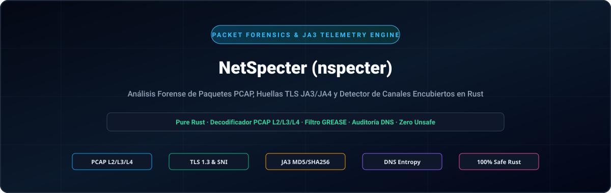
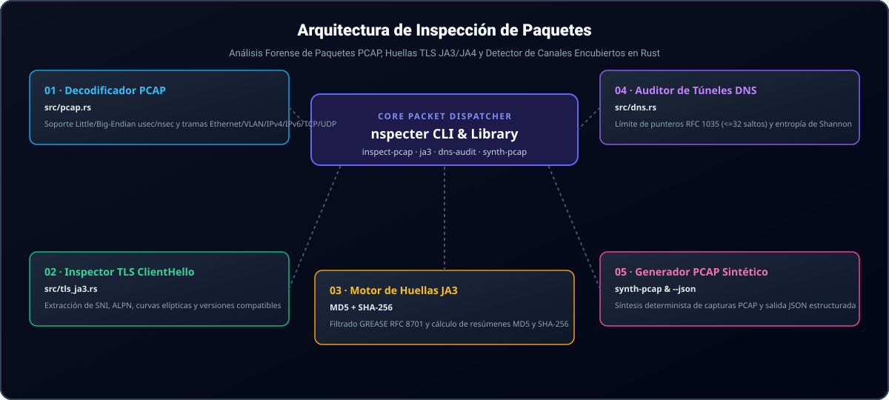

<div align="center">

<p align="center">
  <a href="../../README.md">🇺🇸 English</a> · <a href="./ko.md">🇰🇷 한국어</a> · <a href="./zh-CN.md">🇨🇳 中文</a> · <strong>🇪🇸 Español</strong> · <a href="./hi.md">🇮🇳 हिन्दी</a><br />
  <a href="./ar.md">🇸🇦 العربية</a> · <a href="./pt-BR.md">🇧🇷 Português</a> · <a href="./ru.md">🇷🇺 Русский</a> · <a href="./fr.md">🇫🇷 Français</a> · <a href="./id.md">🇮🇩 Bahasa Indonesia</a>
</p>

<p align="center">
  
</p>

# NetSpecter (nspecter)

**Motor en Rust puro sin dependencias de C para análisis forense de paquetes, huellas TLS JA3/JA4 y detección de canales encubiertos**

[](https://github.com/GHSFS/net-specter/actions/workflows/ci.yml)
[](../../LICENSE)
[](../../Cargo.toml)
[](../../SECURITY.md)

</div>

---

## 🛡️ Descripción general y capacidades principales

<details open>
<summary><b>🛡️ Descripción general y capacidades principales</b></summary>
<br>

net-specter (nspecter) es una utilidad de línea de comandos y biblioteca en Rust puro, diseñada para análisis forense de paquetes sin conexión, huellas criptográficas de enlaces y detección de túneles encubiertos sin dependencias externas de libpcap ni enlaces C.

1. **Motor de captura PCAP y PCAPNG sin dependencias (`src/pcap.rs` y `src/pcapng.rs`)** — Decodifica archivos clásicos libpcap `.pcap` en formatos little-endian y big-endian con marcas de tiempo en microsegundos o nanosegundos (`0xA1B2C3D4`, `0xA1B23C4D`), tramas Ethernet II (con desenvolvimiento de etiquetas VLAN IEEE 802.1Q), capturas Raw IP (`linktype 101`), cabeceras IPv4/IPv6 y segmentos de transporte TCP/UDP. Soporta bloques de cabecera de sección `.pcapng` de última generación (SHB, `0x0A0D0D0A`), bloques de descripción de interfaz (IDB), bloques de paquetes mejorados (EPB) y bloques de paquetes simples (SPB) con cualquier precisión temporal.
2. **Inspector profundo de TLS `ClientHello` y motor JA3 (`src/tls_ja3.rs`)** — Analiza registros de enlace TLS (`0x16`) `ClientHello` (`0x01`), extrayendo nombres de host SNI (`0x0000`), grupos soportados (`0x000a`), formatos de puntos EC (`0x000b`), protocolos ALPN (`0x0010`) y versiones soportadas (`0x002b`). Filtra automáticamente valores GREASE según RFC 8701 (`0x?a?a`) y genera resúmenes **JA3 MD5** y **SHA-256**.
3. **Analizador de formato de red DNS y auditor de túneles encubiertos (`src/dns.rs`)** — Decodifica paquetes DNS según RFC 1035 con estricta protección contra bucles de punteros comprimidos (`<= 32` saltos) y calcula la entropía de Shannon de subdominios, longitudes de etiquetas y densidad hexadecimal/Base32 para alertar canales encubiertos de C2 o fuga de datos (`Low`, `Elevated`, `High`).
4. **Laboratorio de síntesis determinista de paquetes (`nspecter synth-pcap`)** — Genera capturas autocontenidas multipaquete en `.pcap` y `.pcapng` que contienen registros TLS 1.3 `ClientHello` y consultas DNS legítimas o encubiertas para pruebas continuas en CI y validación forense.
5. **Motor de huellas digitales modernas TLS / QUIC JA4 y JA4S (`src/ja4.rs`)** — Genera huellas ordenadas de cliente JA4 compatibles con FoxIO (`t13d1516h2_<cipher_hash>_<ext_hash>`) y respuestas de servidor JA4S inmunes a la aleatorización del orden de extensiones TLS en transportes TCP, QUIC y DTLS.
6. **Reensamblado de flujos TCP y rastreo de segmentos desordenados (`src/tcp_stream.rs`)** — Reconstruye flujos bidireccionales de bytes TCP en paquetes fragmentados, retransmitidos o desordenados, con soporte de desbordamiento de secuencia de 32 bits según RFC 793, límites de memoria contra ataques DoS e inspección profunda de protocolos de aplicación multirráfaga (TLS JA3/JA4, HTTP/1.1, HTTP/2, SSH).
7. **Inspector de tramas HTTP/1.1 y HTTP/2 y huellas JA4H (`src/http_inspect.rs`)** — Analiza peticiones y respuestas HTTP/1.1, decodifica prefacios de conexión HTTP/2, flujos de tramas binarias y parámetros `SETTINGS`, calculando huellas de cliente `JA4H` conforme a FoxIO (`nspecter http-audit`).
8. **Análisis forense de ServerHello JA3S y cadena de certificados X.509 (`src/tls_cert.rs`)** — Extrae huellas de respuesta de servidor JA3S (MD5 y SHA-256 con inmunidad a GREASE RFC 8701), decodifica mensajes de `Certificate` (`0x0b`) en TLS 1.2 y 1.3, proporciona un analizador ASN.1 DER para certificados X.509 (DN de sujeto/emisor, fechas de validez, SAN DNS/IP, números de serie, algoritmos de firma) y señala anomalías en certificados (caducados, aún no válidos, fechas invertidas, firmas débiles, autofirmados) en capturas PCAP, PCAPNG y flujos TCP reensamblados (`nspecter cert-audit`).
9. **Descifrador de paquetes iniciales QUIC y RFC 9001 (`src/quic.rs`, `src/quic_crypto.rs`)** — Deriva claves iniciales mediante HKDF-SHA256, desenmascara la protección de cabecera RFC 9001, descifra paquetes iniciales QUIC con AES-128-GCM en Rust puro, reensambla tramas CRYPTO y extrae huellas TLS 1.3 JA3/JA4 sobre UDP/443 (`nspecter quic-audit`).
10. **Detector de fluctuación (Jitter) y espectrogramas periódicos de balizas C2 (`src/beacon.rs`)** — Analiza deltas entre llegadas de paquetes ($Delta t$), fluctuación media/varianza/mediana, coeficiente de variación ($CV$), espectrogramas de frecuencia de intervalos y puntuaciones de periodicidad para clasificar balizas automatizadas de C2 (`HighConfidenceBeacon`, `JitteredBeacon`, `SuspectInterval`, `Benign`) en PCAP y PCAPNG (`nspecter beacon-audit`).
11. **Motor de expresiones de filtrado estilo BPF (`src/filter/`)** — Evalúa expresiones de filtrado contra rangos CIDR IPv4/IPv6, puertos, protocolos de transporte, máscaras de banderas TCP y longitudes de trama (`nspecter filter`).
12. **Huellas de intercambio de claves SSH HASSH para cliente y servidor (`src/ssh_hassh.rs`)** — Analiza cabeceras de identificación RFC 4253 y paquetes `SSH_MSG_KEXINIT`, calculando huellas MD5 y SHA-256 Salesforce `HASSH` y `HASSHServer` sobre PCAP, PCAPNG y flujos binarios (`nspecter hassh`).

</details>

---

## 🏛️ Arquitectura de inspección de paquetes y huellas

<details open>
<summary><b>🏛️ Arquitectura de inspección de paquetes y huellas</b></summary>
<br>

<p align="center">
  
</p>

| # | Componente | Módulo | Responsabilidad principal |
|---|---|---|---|
| **01** | **01 · Decodificador de cable PCAP** | `src/pcap.rs` | Analizador libpcap en micro/nanosegundos little/big-endian y decodificación Ethernet/VLAN/IPv4/IPv6/TCP/UDP |
| **02** | **02 · Inspector de TLS ClientHello** | `src/tls_ja3.rs` | Extracción zero-copy de SNI, ALPN, grupos soportados, formatos EC y versiones |
| **03** | **03 · Huella criptográfica JA3** | `MD5 + SHA-256` | Filtrado de GREASE RFC 8701, generación de cadenas canónicas JA3 y resúmenes duales |
| **04** | **04 · Auditor de túneles DNS** | `src/dns.rs` | Protección de bucles de punteros RFC 1035 (<=32 saltos) y puntuación C2 por entropía de Shannon |
| **05** | **05 · Laboratorio de síntesis de paquetes** | `synth-pcap & --json` | Generador determinista de PCAP multipaquete y salida de telemetría estructurada en JSON |

</details>

---

## 🚀 Inicio rápido y uso de la línea de comandos

<details open>
<summary><b>🚀 Inicio rápido y uso de la línea de comandos</b></summary>
<br>

```bash
# 1. Compilar el binario optimizado para producción
cargo build --release

# 2. Generar una captura de muestra determinista en formato .pcap o .pcapng (TLS 1.3 ClientHello + paquetes DNS)
./target/release/nspecter synth-pcap sample.pcap
./target/release/nspecter synth-pcap sample.pcapng --pcapng

# 3. Inspeccionar todos los flujos, enlaces TLS JA3 y consultas DNS en una captura (.pcap o .pcapng)
./target/release/nspecter inspect-pcap sample.pcap
./target/release/nspecter inspect-pcap sample.pcapng --json

# 4. Extraer detalles de TLS ClientHello y resúmenes JA3 MD5 / SHA-256 desde una captura o cadena hexadecimal
./target/release/nspecter ja3 sample.pcapng --json

# 5. Extraer huellas de cliente FoxIO JA4 y servidor JA4S desde una captura o cadena hexadecimal
./target/release/nspecter ja4 sample.pcapng --json

# 6. Auditar paquetes DNS en busca de túneles encubiertos de alta entropía y fuga de datos C2
./target/release/nspecter dns-audit sample.pcapng --json

# 7. Reensamblar flujos TCP bidireccionales e inspeccionar las cargas útiles de aplicación
./target/release/nspecter tcp-stream sample.pcapng --json

# 8. Inspeccionar tramas HTTP/1.1 y HTTP/2 y calcular huellas de cliente HTTP JA4H
./target/release/nspecter http-audit capture.pcap --json

# 9. Realizar auditoría forense de huellas TLS ServerHello JA3S y cadenas de certificados X.509
./target/release/nspecter cert-audit capture.pcap --json

# 10. Descifrar paquetes iniciales QUIC y extraer huellas TLS 1.3 JA3/JA4
./target/release/nspecter quic-audit capture.pcap --json

# 11. Auditar la fluctuación de balizas C2 y espectrogramas de intervalos periódicos
./target/release/nspecter beacon-audit capture.pcap --min-events 4 --json

# 12. Filtrar tramas de captura utilizando expresiones de estilo BPF
./target/release/nspecter filter capture.pcap "tcp port 443" --json

# 13. Extraer cabeceras SSH, analizar negociaciones KEXINIT y calcular huellas Salesforce HASSH
./target/release/nspecter hassh capture.pcap --json

# 14. Auditar flujos ICMP Echo Request/Reply para detectar túneles encubiertos y alteración de cargas útiles
./target/release/nspecter icmp-tunnel capture.pcap --dump-payload --json

# 15. Identificar pasivamente sistemas operativos a partir de paquetes TCP SYN (p0f v3 y FoxIO JA4T)
./target/release/nspecter os-fp capture.pcap --json

# 16. Auditar peticiones y respuestas ARP en busca de suplantación, inundación gratuita y anomalías MITM de capa 2
./target/release/nspecter arp-audit capture.pcap --gateway 192.168.1.1 --json
```

</details>

---

## 📦 Referencia de módulos y subcomandos

<details open>
<summary><b>📦 Referencia de módulos y subcomandos</b></summary>
<br>

```text
net-specter/
├── Cargo.toml                     # Manifiesto del crate (biblioteca net-specter y binario nspecter)
├── README.md                      # Documentación principal en inglés
├── ROADMAP.md                     # Capacidades implementadas y hoja de ruta futura
├── CHANGELOG.md                   # Historial de versiones publicadas
├── SECURITY.md                    # Seguridad de memoria y política de reporte de vulnerabilidades
├── LICENSE                        # Licencia Apache-2.0
├── NOTICE                         # Aviso de atribución y copyright (GHSFS)
├── src/
│   ├── lib.rs                     # Exportación de la biblioteca pública
│   ├── main.rs                    # Punto de entrada de la CLI (despachador conciso de <25 líneas)
│   ├── cli.rs                     # Definiciones de subcomandos y argumentos con Clap
│   ├── error.rs                   # Modelo unificado de errores SpecterError y Result<T>
│   ├── commands/                  # Controladores modulares de comandos CLI (arp, inspect, tls, dns, tcp, http, cert, quic, synth, beacon, filter, hassh, icmp, os_fp)
│   ├── filter/                    # Analizador de descenso recursivo y evaluador de filtros estilo BPF
│   ├── arp_audit.rs               # Detector de suplantación ARP RFC 826 / RFC 5227 y ataques MITM en capa 2
│   ├── p0f/                       # Motor pasivo de huellas de SO y FoxIO JA4T/JA4TS
│   ├── icmp_tunnel.rs             # Detector de túneles encubiertos ICMP Echo y manipulación de cargas
│   ├── beacon.rs                  # Detector de fluctuación de balizas C2 y espectrogramas periódicos
│   ├── pcap.rs                    # Decodificador libpcap .pcap, analizador L2/L3/L4 y generador
│   ├── pcapng.rs                  # Analizador de bloques PCAPNG (SHB/IDB/EPB/SPB) y generador
│   ├── quic.rs                    # Extractor de paquetes iniciales QUIC y flujo CRYPTO
│   ├── quic_crypto.rs             # Descifrador en Rust puro para HKDF-SHA256, AES-128 y GCM
│   ├── ssh_hassh.rs               # Cabeceras SSH-2.0 y motor Salesforce HASSH/HASSHServer
│   ├── tls_ja3.rs                 # Analizador TLS ClientHello, filtro GREASE y motor JA3
│   ├── tls_cert.rs                # TLS ServerHello JA3S, certificados TLS 1.2/1.3 y analizador ASN.1 X.509
│   ├── ja4.rs                     # Motor de huellas cliente FoxIO JA4 y servidor JA4S
│   ├── tcp_stream.rs              # Reensamblado con estado de flujos TCP y rastreo fuera de orden
│   ├── http_inspect.rs            # Analizador HTTP/1.1, tramas SETTINGS de HTTP/2 y motor de huellas JA4H
│   └── dns.rs                     # Decodificador DNS RFC 1035 y auditor de túneles por entropía de Shannon
└── tests/
    ├── arp_audit_test.rs          # Pruebas de suplantación ARP, balanceo de puerta de enlace e inundación
    ├── p0f_test.rs                # Pruebas de huellas pasivas de SO por TCP SYN y FoxIO JA4T
    ├── icmp_tunnel_test.rs        # Pruebas de túneles encubiertos ICMP y entropía de Shannon
    ├── beacon_test.rs             # Pruebas de fluctuación de balizas C2, espectrogramas y clasificación
    ├── filter_test.rs             # Pruebas de evaluación de expresiones de filtrado de paquetes estilo BPF
    ├── pcap_tls_test.rs           # Pruebas de PCAP, L2/L3/L4, GREASE y JA3
    ├── pcapng_test.rs             # Pruebas de bloques PCAPNG, marcas temporales en nanosegundos y CLI
    ├── ja4_test.rs                # Pruebas de JA4/JA4S, paquetes QUIC Initial e inmunidad GREASE
    ├── quic_test.rs               # Pruebas de HKDF RFC 9001, AES-GCM y descifrado inicial QUIC
    ├── ssh_hassh_test.rs          # Pruebas de cabeceras SSH, KEXINIT y Salesforce HASSH
    ├── tcp_stream_test.rs         # Pruebas de reensamblado de flujos TCP y cargas TLS multisegmento
    ├── http_inspect_test.rs       # Pruebas de tramas HTTP/1.1, HTTP/2 y huellas JA4H
    ├── tls_cert_test.rs           # Pruebas de ServerHello JA3S, ASN.1 DER X.509 y detección de anomalías
    └── dns_audit_test.rs          # Pruebas de bucles de compresión DNS y detección de túneles encubiertos
```

Consulte [ROADMAP.md](../../ROADMAP.md) para conocer las capacidades de análisis forense y protocolos planificadas.

</details>

---

## 🔒 Seguridad de memoria y robustez del analizador

<details open>
<summary><b>🔒 Seguridad de memoria y robustez del analizador</b></summary>
<br>

- **100% Rust Seguro**: Cero bloques `unsafe` en todos los módulos de decodificación de tramas binarias.
- **Defensa contra bucles de compresión RFC 1035**: La descompresión de nombres DNS impone un límite estricto de 32 saltos de puntero y rechaza automáticamente punteros directos o autorreferenciales.
- **Puesta a cero de búferes sensibles**: Al descartarse, los búferes transitorios con datos aleatorios de TLS, ID de sesión y bytes de reensamblado se borran de forma segura mediante `zeroize`.
- **Búfer de segmentos resistente a ataques DoS**: La cola de segmentos TCP desordenados impone cuotas de memoria estrictas por flujo para evitar el agotamiento de memoria ante ataques de inundación de fragmentos.
- **Política de seguridad y reporte de vulnerabilidades**: Consulte [SECURITY.md](../../SECURITY.md).

</details>

---

## 📄 Licencia y atribución

<details open>
<summary><b>📄 Licencia y atribución</b></summary>
<br>

```text
Copyright 2026 GHSFS

Licensed under the Apache License, Version 2.0 (the "License");
you may not use this file except in compliance with the License.
You may obtain a copy of the License at

    http://www.apache.org/licenses/LICENSE-2.0
```

</details>
