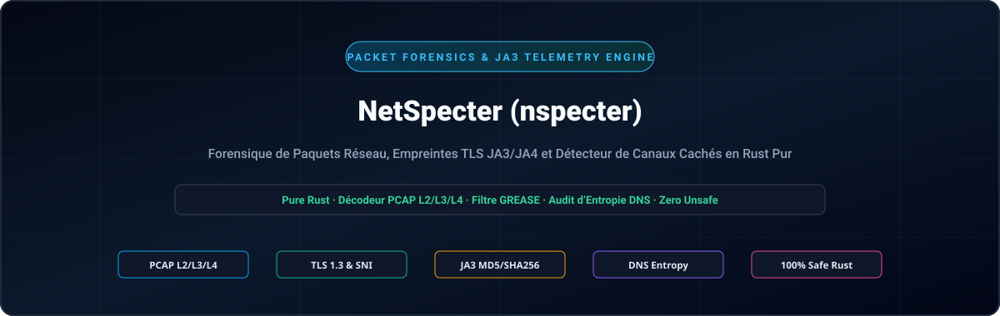
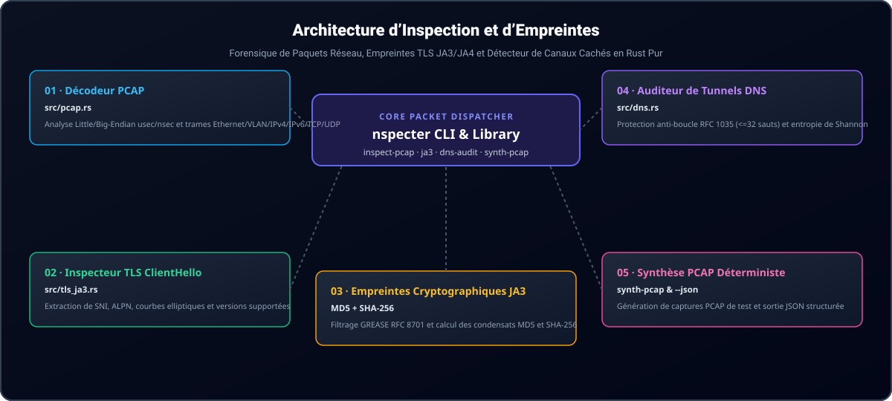

<div align="center">

<p align="center">
  <a href="../../README.md">🇺🇸 English</a> · <a href="./ko.md">🇰🇷 한국어</a> · <a href="./zh-CN.md">🇨🇳 中文</a> · <a href="./es.md">🇪🇸 Español</a> · <a href="./hi.md">🇮🇳 हिन्दी</a><br />
  <a href="./ar.md">🇸🇦 العربية</a> · <a href="./pt-BR.md">🇧🇷 Português</a> · <a href="./ru.md">🇷🇺 Русский</a> · <strong>🇫🇷 Français</strong> · <a href="./id.md">🇮🇩 Bahasa Indonesia</a>
</p>

<p align="center">
  
</p>

# NetSpecter (nspecter)

**Moteur en pur Rust sans dépendances C pour l'analyse forensique de paquets réseau, les empreintes TLS JA3/JA4 et la détection de canaux dissimulés**

[](https://github.com/GHSFS/net-specter/actions/workflows/ci.yml)
[](../../LICENSE)
[](../../Cargo.toml)
[](../../SECURITY.md)

</div>

---

## 🛡️ Aperçu et fonctionnalités clés

<details open>
<summary><b>🛡️ Aperçu et fonctionnalités clés</b></summary>
<br>

net-specter (nspecter) est un utilitaire en ligne de commande et une bibliothèque en pur Rust, ultra-rapide et sûr en mémoire, conçu pour l'analyse forensique hors ligne de paquets réseau, l'extraction d'empreintes cryptographiques de négociation et la détection de tunnels dissimulés sans dépendance externe à libpcap ni liaisons C.

1. **Moteur de capture PCAP et PCAPNG sans dépendance (`src/pcap.rs` et `src/pcapng.rs`)** — Décode les fichiers classiques libpcap `.pcap` aux formats little-endian et big-endian avec horodatages en microsecondes et nanosecondes (`0xA1B2C3D4`, `0xA1B23C4D`), les trames Ethernet II (avec extraction des balises VLAN IEEE 802.1Q), les captures Raw IP (`linktype 101`), les en-têtes IPv4/IPv6 et les segments de transport TCP/UDP. Prend en charge les blocs d'en-tête de section `.pcapng` de nouvelle génération (SHB `0x0A0D0D0A`), les blocs de description d'interface (IDB), les blocs de paquets améliorés (EPB) et les blocs de paquets simples (SPB) avec une précision temporelle arbitraire.
2. **Inspecteur approfondi de TLS `ClientHello` et moteur JA3 (`src/tls_ja3.rs`)** — Analyse les enregistrements de négociation TLS (`0x16`) `ClientHello` (`0x01`), extrait les noms d'hôtes SNI (`0x0000`), les groupes pris en charge (`0x000a`), les formats de points EC (`0x000b`), les protocoles ALPN (`0x0010`) et les versions prises en charge (`0x002b`). Filtre automatiquement les valeurs GREASE RFC 8701 (`0x?a?a`) et génère les condensats d'empreintes **JA3 MD5** et **SHA-256**.
3. **Analyseur de format filaire DNS et auditeur de tunnels dissimulés (`src/dns.rs`)** — Décode les paquets DNS RFC 1035 avec une protection stricte contre les boucles de pointeurs compressés (`<= 32` sauts) et évalue l'entropie de Shannon des sous-domaines, la longueur des étiquettes et la densité de charge utile hexadécimale/Base32 pour signaler les canaux C2 ou d'exfiltration de données (`Low`, `Elevated`, `High`).
4. **Laboratoire de synthèse déterministe de paquets (`nspecter synth-pcap`)** — Génère des fichiers de capture autonomes multi-paquets `.pcap` et `.pcapng` contenant des enregistrements TLS 1.3 `ClientHello` et des requêtes DNS légitimes ou dissimulées pour des tests d'intégration continue reproductibles et la validation par les analystes.
5. **Moteur d'empreintes digitales modernes TLS / QUIC JA4 et JA4S (`src/ja4.rs`)** — Calcule des empreintes de client JA4 triées conformes à FoxIO (`t13d1516h2_<cipher_hash>_<ext_hash>`) et des réponses de serveur JA4S insensibles à la randomisation de l'ordre des extensions TLS sur les transports TCP, QUIC et DTLS.
6. **Réassemblage de flux TCP et suivi des segments désordonnés (`src/tcp_stream.rs`)** — Reconstitue les flux bidirectionnels d'octets TCP à travers des segments fragmentés, retransmis et désordonnés avec gestion du bouclage de séquence 32 bits RFC 793, quotas de mémoire anti-déni de service (DoS) et inspection approfondie des protocoles applicatifs (TLS JA3/JA4, HTTP/1.1, HTTP/2, SSH).
7. **Inspecteur de trames HTTP/1.1 et HTTP/2 et empreintes JA4H (`src/http_inspect.rs`)** — Analyse les requêtes et réponses HTTP/1.1, décode les préfaces de connexion HTTP/2, les flux de trames binaires et les paramètres `SETTINGS`, calculant les empreintes de client `JA4H` conformes aux normes FoxIO (`nspecter http-audit`).
8. **Analyse forensique de ServerHello JA3S et chaîne de certificats X.509 (`src/tls_cert.rs`)** — Extrait les empreintes de réponse de serveur JA3S (MD5 et SHA-256 avec immunité GREASE RFC 8701), décode les messages `Certificate` (`0x0b`) de TLS 1.2 et 1.3 ; intègre un analyseur ASN.1 DER autonome pour les certificats X.509 et détecte les anomalies (expirés, non encore valides, dates inversées, algorithmes faibles, auto-signés) sur PCAP, PCAPNG et flux TCP réassemblés (`nspecter cert-audit`).
9. **Déchiffreur de paquets initiaux QUIC et RFC 9001 (`src/quic.rs`, `src/quic_crypto.rs`)** — Dérive les clés initiales via HKDF-SHA256, démasque la protection d'en-tête RFC 9001, déchiffre les paquets QUIC Initial avec AES-128-GCM en pur Rust, rassemble les trames CRYPTO et extrait les empreintes TLS 1.3 JA3/JA4 sur UDP/443 (`nspecter quic-audit`).
10. **Détecteur de gigue (Jitter) de balises C2 et spectrogrammes d'intervalles périodiques (`src/beacon.rs`)** — Analyse les deltas d'inter-arrivée ($Delta t$), la gigue moyenne/variance/médiane, le coefficient de variation ($CV$), les spectrogrammes de fréquence des intervalles et les scores de périodicité pour classifier les signaux C2 automatisés (`HighConfidenceBeacon`, `JitteredBeacon`, `SuspectInterval`, `Benign`) dans PCAP et PCAPNG (`nspecter beacon-audit`).
11. **Moteur d'évaluation d'expressions de filtrage de style BPF (`src/filter/`)** — Évalue les expressions de filtrage de paquets par blocs CIDR IPv4/IPv6, plages de ports, protocoles de transport, masques d'indicateurs TCP et tailles de trames (`nspecter filter`).
12. **Empreintes d'échange de clés SSH HASSH pour client et serveur (`src/ssh_hassh.rs`)** — Analyse les bannières d'identification RFC 4253 et les paquets `SSH_MSG_KEXINIT`, calculant les empreintes MD5 et SHA-256 Salesforce `HASSH` et `HASSHServer` sur PCAP, PCAPNG et flux bruts d'octets (`nspecter hassh`).

</details>

---

## 🏛️ Architecture d'inspection des paquets et d'empreintes

<details open>
<summary><b>🏛️ Architecture d'inspection des paquets et d'empreintes</b></summary>
<br>

<p align="center">
  
</p>

| # | Composant | Module | Responsabilité principale |
|---|---|---|---|
| **01** | **01 · Décodeur filaire PCAP** | `src/pcap.rs` | Analyseur libpcap en micro/nanosecondes little/big-endian et décodage Ethernet/VLAN/IPv4/IPv6/TCP/UDP |
| **02** | **02 · Inspecteur TLS ClientHello** | `src/tls_ja3.rs` | Extraction sans copie de SNI, ALPN, groupes pris en charge, formats EC et versions |
| **03** | **03 · Empreinte cryptographique JA3** | `MD5 + SHA-256` | Filtrage de GREASE RFC 8701, génération de chaînes canoniques JA3 et calcul du double condensat |
| **04** | **04 · Auditeur de tunnels DNS** | `src/dns.rs` | Protection anti-boucle de pointeurs RFC 1035 (<=32 sauts) et évaluation C2 par entropie de Shannon |
| **05** | **05 · Laboratoire de synthèse de paquets** | `synth-pcap & --json` | Générateur déterministe de PCAP multi-paquets et télémétrie structurée en JSON |

</details>

---

## 🚀 Démarrage rapide et commandes CLI

<details open>
<summary><b>🚀 Démarrage rapide et commandes CLI</b></summary>
<br>

```bash
# 1. Compiler le binaire optimisé pour la production
cargo build --release

# 2. Générer une capture d'échantillon déterministe en format .pcap ou .pcapng (TLS 1.3 ClientHello + requêtes DNS)
./target/release/nspecter synth-pcap sample.pcap
./target/release/nspecter synth-pcap sample.pcapng --pcapng

# 3. Inspecter tous les flux, négociations TLS JA3 et requêtes DNS dans une capture (.pcap ou .pcapng)
./target/release/nspecter inspect-pcap sample.pcap
./target/release/nspecter inspect-pcap sample.pcapng --json

# 4. Extraire les détails TLS ClientHello et les condensats JA3 MD5 / SHA-256 depuis une capture ou chaîne hexadécimale
./target/release/nspecter ja3 sample.pcapng --json

# 5. Extraire les empreintes client FoxIO JA4 et serveur JA4S depuis une capture ou chaîne hexadécimale
./target/release/nspecter ja4 sample.pcapng --json

# 6. Auditer les paquets DNS pour détecter les tunnels dissimulés à haute entropie et l'exfiltration C2
./target/release/nspecter dns-audit sample.pcapng --json

# 7. Réassembler les flux TCP bidirectionnels et inspecter les charges utiles applicatives
./target/release/nspecter tcp-stream sample.pcapng --json

# 8. Inspecter les trames HTTP/1.1 et HTTP/2 et calculer les empreintes de client HTTP JA4H
./target/release/nspecter http-audit capture.pcap --json

# 9. Réaliser un audit forensique des empreintes TLS ServerHello JA3S et des chaînes de certificats X.509
./target/release/nspecter cert-audit capture.pcap --json

# 10. Déchiffrer les paquets QUIC Initial et extraire les empreintes TLS 1.3 JA3/JA4
./target/release/nspecter quic-audit capture.pcap --json

# 11. Auditer la gigue (jitter) des balises C2 et les spectrogrammes d'intervalles périodiques
./target/release/nspecter beacon-audit capture.pcap --min-events 4 --json

# 12. Filtrer les trames de capture à l'aide d'expressions de style BPF
./target/release/nspecter filter capture.pcap "tcp port 443" --json

# 13. Extraire les bannières SSH, analyser les négociations KEXINIT et calculer les empreintes Salesforce HASSH
./target/release/nspecter hassh capture.pcap --json

# 14. Auditer les flux ICMP Echo Request/Reply pour détecter les tunnels et les altérations de données
./target/release/nspecter icmp-tunnel capture.pcap --dump-payload --json

# 15. Identifier passivement les systèmes d'exploitation à partir des paquets TCP SYN (p0f v3 et FoxIO JA4T)
./target/release/nspecter os-fp capture.pcap --json

# 16. Auditer les requêtes et réponses ARP pour détecter l'usurpation, les inondations et les anomalies MITM L2
./target/release/nspecter arp-audit capture.pcap --gateway 192.168.1.1 --json
```

</details>

---

## 📦 Référence des modules et sous-commandes

<details open>
<summary><b>📦 Référence des modules et sous-commandes</b></summary>
<br>

```text
net-specter/
├── Cargo.toml                     # Manifeste du crate (bibliothèque net-specter et binaire nspecter)
├── README.md                      # Documentation principale en anglais
├── ROADMAP.md                     # Fonctionnalités livrées et feuille de route future
├── CHANGELOG.md                   # Historique des versions publiées
├── SECURITY.md                    # Sécurité de la mémoire et politique de signalement des vulnérabilités
├── LICENSE                        # Licence Apache-2.0
├── NOTICE                         # Avis d'attribution et de droit d'auteur (GHSFS)
├── src/
│   ├── lib.rs                     # Exportations de l'interface publique de la bibliothèque
│   ├── main.rs                    # Point d'entrée de la CLI (répartiteur concis de <25 lignes)
│   ├── cli.rs                     # Définitions des sous-commandes et arguments avec Clap
│   ├── error.rs                   # Modèle d'erreur unifié SpecterError et Result<T>
│   ├── commands/                  # Gestionnaires modulaires des commandes CLI (arp, inspect, tls, dns, tcp, http, cert, quic, synth, beacon, filter, hassh, icmp, os_fp)
│   ├── filter/                    # Analyseur à descente récursive et évaluateur de filtres de style BPF
│   ├── arp_audit.rs               # Détecteur d'usurpation ARP RFC 826 / RFC 5227 et attaques MITM niveau 2
│   ├── p0f/                       # Moteur passif d'empreintes d'OS et FoxIO JA4T/JA4TS
│   ├── icmp_tunnel.rs             # Détecteur de tunnels dissimulés ICMP Echo et altération de charge utile
│   ├── beacon.rs                  # Détecteur de gigue de balises C2 et spectrogrammes d'intervalles
│   ├── pcap.rs                    # Décodeur libpcap .pcap, analyseur L2/L3/L4 et générateur
│   ├── pcapng.rs                  # Analyseur de blocs PCAPNG (SHB/IDB/EPB/SPB) et générateur
│   ├── quic.rs                    # Extracteur de paquets initiaux QUIC et flux CRYPTO
│   ├── quic_crypto.rs             # Déchiffreur en pur Rust pour HKDF-SHA256, AES-128 et GCM
│   ├── ssh_hassh.rs               # Bannières SSH-2.0 et moteur Salesforce HASSH/HASSHServer
│   ├── tls_ja3.rs                 # Analyseur TLS ClientHello, filtre GREASE et moteur JA3
│   ├── tls_cert.rs                # TLS ServerHello JA3S, certificats TLS 1.2/1.3 et analyseur ASN.1 X.509
│   ├── ja4.rs                     # Moteur d'empreintes modernes FoxIO JA4 client et JA4S serveur
│   ├── tcp_stream.rs              # Réassemblage d'état des flux TCP et suivi hors ordre
│   ├── http_inspect.rs            # Analyseur HTTP/1.1, trames HTTP/2 SETTINGS et moteur d'empreintes JA4H
│   └── dns.rs                     # Décodeur DNS RFC 1035 et auditeur de tunnels par entropie de Shannon
└── tests/
    ├── arp_audit_test.rs          # Tests d'usurpation ARP, battement de passerelle et inondation
    ├── p0f_test.rs                # Tests d'empreintes passives d'OS par TCP SYN et FoxIO JA4T
    ├── icmp_tunnel_test.rs        # Tests de tunnels dissimulés ICMP et entropie de Shannon
    ├── beacon_test.rs             # Tests de gigue de balises C2, spectrogrammes et classification
    ├── filter_test.rs             # Tests d'évaluation d'expressions de filtrage de paquets style BPF
    ├── pcap_tls_test.rs           # Tests d'intégration PCAP, L2-L4, GREASE et JA3
    ├── pcapng_test.rs             # Tests de blocs PCAPNG, horodatages nanosecondes et commandes CLI
    ├── ja4_test.rs                # Tests d'empreintes JA4/JA4S, paquets QUIC Initial et immunité GREASE
    ├── quic_test.rs               # Tests de dérivation de clés HKDF RFC 9001, AES-GCM et QUIC Initial
    ├── ssh_hassh_test.rs          # Tests de bannières SSH, KEXINIT et Salesforce HASSH
    ├── tcp_stream_test.rs         # Tests de réassemblage de flux TCP et charges TLS multisegments
    ├── http_inspect_test.rs       # Tests de trames HTTP/1.1, HTTP/2 et empreintes JA4H
    ├── tls_cert_test.rs           # Tests de ServerHello JA3S, ASN.1 DER X.509 et détection d'anomalies
    └── dns_audit_test.rs          # Tests anti-boucle de compression DNS et détection de tunnels
```

Consultez [ROADMAP.md](../../ROADMAP.md) pour les capacités forensiques réseau et de protocoles planifiées.

</details>

---

## 🔒 Sécurité de la mémoire et durcissement des analyseurs

<details open>
<summary><b>🔒 Sécurité de la mémoire et durcissement des analyseurs</b></summary>
<br>

- **100% Rust Sûr** : Zéro bloc `unsafe` dans l'ensemble des modules de décodage des trames binaires.
- **Défense anti-boucle de compression RFC 1035** : La décompression des noms DNS applique une limite stricte de 32 sauts de pointeurs et rejette immédiatement les pointeurs prospectifs ou autoréférentiels.
- **Remise à zéro des tampons sensibles** : Lors de leur désallocation, les tampons transitoires contenant des nombres aléatoires TLS, des ID de session et des octets de réassemblage sont effacés en toute sécurité via `zeroize`.
- **Mise en mémoire tampon des segments résistante aux DoS** : La file d'attente des segments TCP hors ordre applique des quotas de mémoire stricts par flux pour empêcher l'épuisement des ressources par des inondations de fragments.
- **Politique de sécurité et signalement des vulnérabilités** : Voir [SECURITY.md](../../SECURITY.md).

</details>

---

## 📄 Licence et mentions d'attribution

<details open>
<summary><b>📄 Licence et mentions d'attribution</b></summary>
<br>

```text
Copyright 2026 GHSFS

Licensed under the Apache License, Version 2.0 (the "License");
you may not use this file except in compliance with the License.
You may obtain a copy of the License at

    http://www.apache.org/licenses/LICENSE-2.0
```

</details>
