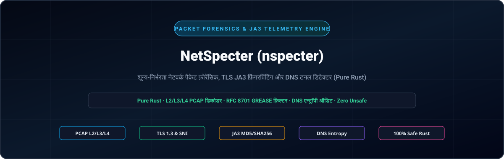
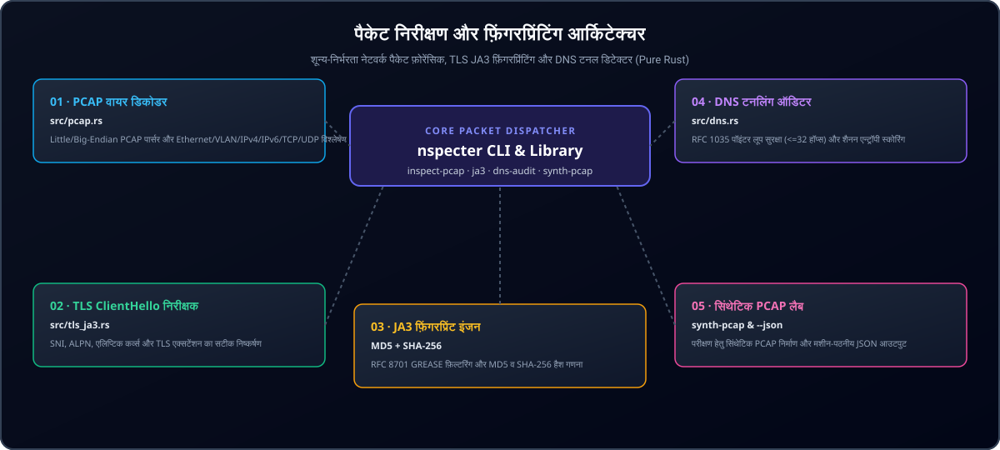

<div align="center">

<p align="center">
  <a href="../../README.md">🇺🇸 English</a> · <a href="./ko.md">🇰🇷 한국어</a> · <a href="./zh-CN.md">🇨🇳 中文</a> · <a href="./es.md">🇪🇸 Español</a> · <strong>🇮🇳 हिन्दी</strong><br />
  <a href="./ar.md">🇸🇦 العربية</a> · <a href="./pt-BR.md">🇧🇷 Português</a> · <a href="./ru.md">🇷🇺 Русский</a> · <a href="./fr.md">🇫🇷 Français</a> · <a href="./id.md">🇮🇩 Bahasa Indonesia</a>
</p>

<p align="center">
  
</p>

# NetSpecter (nspecter)

**शून्य C निर्भरता वाला शुद्ध Rust नेटवर्क पैकेट फोरेंसिक, TLS JA3/JA4 फ़िंगरप्रिंटिंग और गुप्त टनलिंग पहचान इंजन**

[](https://github.com/GHSFS/net-specter/actions/workflows/ci.yml)
[](../../LICENSE)
[](../../Cargo.toml)
[](../../SECURITY.md)

</div>

---

## 🛡️ विवरण एवं मुख्य क्षमताएँ

<details open>
<summary><b>🛡️ विवरण एवं मुख्य क्षमताएँ</b></summary>
<br>

net-specter (nspecter) एक उच्च-गति, मेमोरी-सुरक्षित कमांड-लाइन टूल और Rust लाइब्रेरी है, जिसे बिना किसी libpcap या C निर्भरता के ऑफ़लाइन नेटवर्क पैकेट फोरेंसिक, क्रिप्टोग्राफ़िक हैंडशेक फ़िंगरप्रिंटिंग और गुप्त टनलिंग की पहचान हेतु विकसित किया गया है।

1. **शून्य-निर्भरता PCAP और PCAPNG कैप्चर इंजन (`src/pcap.rs` और `src/pcapng.rs`)** — लिटिल-एंडियन और बिग-एंडियन माइक्रोसेकंड/नैनोसेकंड हेडर (`0xA1B2C3D4`, `0xA1B23C4D`), Ethernet II फ़्रेम (IEEE 802.1Q VLAN टैग अनरैपिंग सहित), Raw IP कैप्चर (`linktype 101`), IPv4/IPv6 हेडर और TCP/UDP ट्रांसपोर्ट सेगमेंट को डिकोड करता है; साथ ही मनमानी टाइमस्टैम्प सटीकता वाले अगली पीढ़ी के `.pcapng` सेक्शन हेडर ब्लॉक (SHB, `0x0A0D0D0A`), इंटरफ़ेस डिस्क्रिप्शन ब्लॉक (IDB), एन्हांस्ड पैकेट ब्लॉक (EPB) और सिंपल पैकेट ब्लॉक (SPB) का पूर्ण समर्थन करता है।
2. **TLS `ClientHello` गहन निरीक्षक एवं JA3 इंजन (`src/tls_ja3.rs`)** — TLS हैंडशेक (`0x16`) `ClientHello` (`0x01`) रिकॉर्ड को पार्स करता है, SNI होस्टनाम (`0x0000`), समर्थित समूह (`0x000a`), EC पॉइंट फ़ॉर्मेट (`0x000b`), ALPN प्रोटोकॉल (`0x0010`) और समर्थित संस्करण (`0x002b`) निकालता है; RFC 8701 GREASE मानों (`0x?a?a`) को स्वचालित रूप से फ़िल्टर करके मानक **JA3 MD5** और **SHA-256** फ़िंगरप्रिंट की गणना करता है।
3. **DNS वायर-फ़ॉर्मेट पार्सर एवं गुप्त टनलिंग ऑडिटर (`src/dns.rs`)** — कड़े कम्प्रेशन पॉइंटर लूप संरक्षण (`<= 32` हॉप्स) के साथ RFC 1035 DNS पैकेट को डिकोड करता है, और सबडोमेन शैनन एंट्रॉपी, लेबल लंबाई और हेक्साडेसिमल/Base32 पेलोड घनत्व का विश्लेषण करके गुप्त C2 या डेटा रिसाव चैनलों की पहचान करता है (`Low`, `Elevated`, `High`)।
4. **सटीक पैकेट संश्लेषण प्रयोगशाला (`nspecter synth-pcap`)** — दोहराने योग्य CI परीक्षण और विश्लेषक सत्यापन के लिए TLS 1.3 `ClientHello` और सामान्य/गुप्त DNS प्रश्नों से युक्त स्वचालित मल्टी-पैकेट `.pcap` और `.pcapng` फ़ाइलें उत्पन्न करता है।
5. **JA4 और JA4S आधुनिक TLS / QUIC फ़िंगरप्रिंटिंग इंजन (`src/ja4.rs`)** — TCP, QUIC और DTLS ट्रांसपोर्ट पर TLS एक्सटेंशन क्रम यादृच्छिकीकरण के प्रतिरोधी FoxIO-संगत क्रमबद्ध JA4 क्लाइंट फ़िंगरप्रिंट (`t13d1516h2_<cipher_hash>_<ext_hash>`) और JA4S सर्वर प्रतिक्रिया फ़िंगरप्रिंट उत्पन्न करता है।
6. **TCP स्ट्रीम री-असेंबली और आउट-ऑफ़-ऑर्डर सेगमेंट ट्रैकर (`src/tcp_stream.rs`)** — खंडित, पुन: प्रेषित और क्रमहीन सेगमेंट के पार द्विदिशीय TCP बाइट स्ट्रीम का पुनर्निर्माण करता है, जिसमें RFC 793 32-बिट अनुक्रम रैप-अराउंड, DoS मेमोरी सीमाएँ और मल्टी-सेगमेंट एप्लिकेशन प्रोटोकॉल निरीक्षण (TLS JA3/JA4, HTTP/1.1, HTTP/2, SSH) शामिल हैं।
7. **HTTP/1.1 और HTTP/2 फ़्रेम निरीक्षक एवं JA4H फ़िंगरप्रिंटिंग (`src/http_inspect.rs`)** — HTTP/1.1 अनुरोधों और प्रतिक्रियाओं को पार्स करता है, HTTP/2 कनेक्शन प्रस्तावना, बाइनरी फ़्रेम स्ट्रीम और `SETTINGS` मापदंडों को डिकोड करता है, और FoxIO-संगत `JA4H` क्लाइंट फ़िंगरप्रिंट की गणना करता है (`nspecter http-audit`)।
8. **TLS ServerHello JA3S एवं X.509 प्रमाणपत्र शृंखला फोरेंसिक (`src/tls_cert.rs`)** — JA3S सर्वर प्रतिक्रिया फ़िंगरप्रिंट निकालता है (RFC 8701 GREASE प्रतिरक्षा MD5 और SHA-256), TLS 1.2 और TLS 1.3 `Certificate` (`0x0b`) संदेशों को डिकोड करता है; X.509 प्रमाणपत्रों के लिए शून्य-निर्भरता ASN.1 DER पार्सर प्रदान करता है और PCAP, PCAPNG तथा पुनर्गठित TCP स्ट्रीम में प्रमाणपत्र विसंगतियों (समाप्त, अग्रिम, अमान्य, कमजोर हस्ताक्षर, स्व-हस्ताक्षरित) की पहचान करता है (`nspecter cert-audit`)।
9. **QUIC प्रारंभिक पैकेट एवं RFC 9001 डिक्रिप्टर (`src/quic.rs`, `src/quic_crypto.rs`)** — HKDF-SHA256 द्वारा प्रारंभिक कुंजियाँ प्राप्त करता है, RFC 9001 हेडर सुरक्षा मास्क हटाता है, शुद्ध Rust AES-128-GCM से QUIC प्रारंभिक पैकेट डिक्रिप्ट करता है, CRYPTO फ़्रेम को पुनः संयोजित करता है और UDP/443 पर TLS 1.3 JA3/JA4 फ़िंगरप्रिंट निकालता है (`nspecter quic-audit`)।
10. **C2 बीकन जिटर एवं आवधिक अंतराल स्पेक्ट्रोग्राम संसूचक (`src/beacon.rs`)** — स्वचालित C2 हार्टबीट को वर्गीकृत करने के लिए आगमन अंतराल डेल्टा ($Delta t$), औसत/विचरण/माध्यिका जिटर, परिवर्तनशीलता गुणांक ($CV$), अंतराल आवृत्ति स्पेक्ट्रोग्राम और आवधिकता स्कोर का विश्लेषण करता है (`HighConfidenceBeacon`, `JitteredBeacon`, `SuspectInterval`, `Benign`) (`nspecter beacon-audit`)।
11. **BPF-शैली पैकेट फ़िल्टर अभिव्यक्ति इंजन (`src/filter/`)** — IPv4/IPv6 CIDR, पोर्ट रेंज, ट्रांसपोर्ट प्रोटोकॉल, TCP फ़्लैग मास्क और फ़्रेम लंबाई के विरुद्ध पैकेट फ़िल्टर का मूल्यांकन करता है (`nspecter filter`)।
12. **SSH HASSH क्लाइंट और सर्वर कुंजी-विनिमय फ़िंगरप्रिंटिंग (`src/ssh_hassh.rs`)** — RFC 4253 SSH बैनर और `SSH_MSG_KEXINIT` पैकेट को पार्स करता है, PCAP, PCAPNG और रॉ बाइट स्ट्रीम पर Salesforce `HASSH` और `HASSHServer` MD5 व SHA-256 फ़िंगरप्रिंट की गणना करता है (`nspecter hassh`)।

</details>

---

## 🏛️ पैकेट निरीक्षण और फ़िंगरप्रिंटिंग वास्तुकला

<details open>
<summary><b>🏛️ पैकेट निरीक्षण और फ़िंगरप्रिंटिंग वास्तुकला</b></summary>
<br>

<p align="center">
  
</p>

| # | घटक (Component) | मॉड्यूल (Module) | मुख्य जिम्मेदारी (Responsibility) |
|---|---|---|---|
| **01** | **01 · PCAP वायर डिकोडर** | `src/pcap.rs` | लिटिल/बिग-एंडियन libpcap पार्सर और Ethernet/VLAN/IPv4/IPv6/TCP/UDP डिकोडिंग |
| **02** | **02 · TLS ClientHello निरीक्षक** | `src/tls_ja3.rs` | शून्य-कॉपी SNI, ALPN, समर्थित समूह, EC फ़ॉर्मेट और संस्करण निष्कर्षण |
| **03** | **03 · JA3 क्रिप्टोग्राफ़िक फ़िंगरप्रिंटिंग** | `MD5 + SHA-256` | RFC 8701 GREASE फ़िल्टरिंग, विहित JA3 स्ट्रिंग और दोहरी हैश गणना |
| **04** | **04 · DNS टनलिंग ऑडिटर** | `src/dns.rs` | RFC 1035 पॉइंटर लूप सुरक्षा (<=32 हॉप्स) और शैनन एंट्रॉपी C2 स्कोरिंग |
| **05** | **05 · पैकेट संश्लेषण प्रयोगशाला** | `synth-pcap & --json` | सटीक मल्टी-पैकेट PCAP जनरेटर और संरचित JSON टेलीमेट्री आउटपुट |

</details>

---

## 🚀 त्वरित शुरुआत एवं CLI उपयोग

<details open>
<summary><b>🚀 त्वरित शुरुआत एवं CLI उपयोग</b></summary>
<br>

```bash
# 1. प्रोडक्शन रिलीज़ बाइनरी का निर्माण करें
cargo build --release

# 2. नमूना .pcap या .pcapng कैप्चर फ़ाइल उत्पन्न करें (TLS 1.3 ClientHello + DNS पैकेट)
./target/release/nspecter synth-pcap sample.pcap
./target/release/nspecter synth-pcap sample.pcapng --pcapng

# 3. कैप्चर फ़ाइल (.pcap या .pcapng) के सभी प्रवाह, TLS JA3 हैंडशेक और DNS प्रश्नों का निरीक्षण करें
./target/release/nspecter inspect-pcap sample.pcap
./target/release/nspecter inspect-pcap sample.pcapng --json

# 4. कैप्चर या हेक्स स्ट्रिंग से TLS ClientHello विवरण और JA3 MD5 / SHA-256 डाइजेस्ट निकालें
./target/release/nspecter ja3 sample.pcapng --json

# 5. कैप्चर या हेक्स स्ट्रिंग से FoxIO JA4 क्लाइंट और JA4S सर्वर फ़िंगरप्रिंट निकालें
./target/release/nspecter ja4 sample.pcapng --json

# 6. उच्च-एंट्रॉपी गुप्त टनलिंग और C2 डेटा रिसाव के लिए DNS पैकेट का ऑडिट करें
./target/release/nspecter dns-audit sample.pcapng --json

# 7. द्विदिशीय TCP स्ट्रीम को पुनः संयोजित करें और एप्लिकेशन पेलोड का निरीक्षण करें
./target/release/nspecter tcp-stream sample.pcapng --json

# 8. HTTP/1.1 और HTTP/2 फ़्रेम का निरीक्षण करें और JA4H क्लाइंट फ़िंगरप्रिंट की गणना करें
./target/release/nspecter http-audit capture.pcap --json

# 9. TLS ServerHello JA3S फ़िंगरप्रिंट और X.509 प्रमाणपत्र शृंखला का फोरेंसिक ऑडिट करें
./target/release/nspecter cert-audit capture.pcap --json

# 10. QUIC Initial पैकेट डिक्रिप्ट करें और TLS 1.3 JA3/JA4 फ़िंगरप्रिंट निकालें
./target/release/nspecter quic-audit capture.pcap --json

# 11. C2 बीकन जिटर और आवधिक अंतराल स्पेक्ट्रोग्राम का ऑडिट करें
./target/release/nspecter beacon-audit capture.pcap --min-events 4 --json

# 12. BPF-शैली अभिव्यक्तियों का उपयोग करके कैप्चर किए गए फ़्रेम फ़िल्टर करें
./target/release/nspecter filter capture.pcap "tcp port 443" --json

# 13. SSH बैनर निकालें, KEXINIT वार्ता पार्स करें और Salesforce HASSH फ़िंगरप्रिंट की गणना करें
./target/release/nspecter hassh capture.pcap --json

# 14. गुप्त टनल और पेलोड छेड़छाड़ के लिए ICMP Echo Request/Reply प्रवाह का ऑडिट करें
./target/release/nspecter icmp-tunnel capture.pcap --dump-payload --json

# 15. TCP SYN पैकेट से ऑपरेटिंग सिस्टम की निष्क्रिय फ़िंगरप्रिंटिंग करें (p0f v3 और FoxIO JA4T)
./target/release/nspecter os-fp capture.pcap --json

# 16. स्पूफ़िंग, ग्रैच्युइटस फ्लडिंग और लेयर-2 MITM विसंगतियों के लिए ARP अनुरोध/प्रतिक्रिया ऑडिट करें
./target/release/nspecter arp-audit capture.pcap --gateway 192.168.1.1 --json
```

</details>

---

## 📦 मॉड्यूल एवं सब-कमांड निर्देशिका

<details open>
<summary><b>📦 मॉड्यूल एवं सब-कमांड निर्देशिका</b></summary>
<br>

```text
net-specter/
├── Cargo.toml                     # क्रेट मैनिफ़ेस्ट (net-specter लाइब्रेरी और nspecter बाइनरी)
├── README.md                      # प्राथमिक अंग्रेजी दस्तावेज़ीकरण
├── ROADMAP.md                     # कार्यान्वित क्षमताएँ और भविष्य का रोडमैप
├── CHANGELOG.md                   # संस्करण रिलीज़ इतिहास
├── SECURITY.md                    # मेमोरी सुरक्षा और भेद्यता रिपोर्टिंग नीति
├── LICENSE                        # Apache-2.0 लाइसेंस
├── NOTICE                         # एट्रिब्यूशन और कॉपीराइट नोटिस (GHSFS)
├── src/
│   ├── lib.rs                     # सार्वजनिक लाइब्रेरी इंटरफ़ेस
│   ├── main.rs                    # CLI प्रवेश बिंदु (<25 पंक्तियों का डिस्पैचर)
│   ├── cli.rs                     # Clap सब-कमांड और तर्क परिभाषाएँ
│   ├── error.rs                   # एकीकृत SpecterError और Result<T>
│   ├── commands/                  # मॉड्यूलर CLI कमांड हैंडलर (arp, inspect, tls, dns, tcp, http, cert, quic, synth, beacon, filter, hassh, icmp, os_fp)
│   ├── filter/                    # BPF-शैली पुनरावर्ती-अवरोही फ़िल्टर पार्सर और मूल्यांकक
│   ├── arp_audit.rs               # RFC 826 / RFC 5227 ARP स्पूफ़िंग और L2 MITM संसूचक
│   ├── p0f/                       # निष्क्रिय OS फ़िंगरप्रिंटिंग और FoxIO JA4T/JA4TS इंजन
│   ├── icmp_tunnel.rs             # ICMP Echo गुप्त टनल और पेलोड छेड़छाड़ संसूचक
│   ├── beacon.rs                  # C2 बीकन जिटर और अंतराल स्पेक्ट्रोग्राम संसूचक
│   ├── pcap.rs                    # Libpcap .pcap डिकोडर, L2/L3/L4 पार्सर और जनरेटर
│   ├── pcapng.rs                  # PCAPNG ब्लॉक पार्सर (SHB/IDB/EPB/SPB) और जनरेटर
│   ├── quic.rs                    # QUIC Initial पैकेट और CRYPTO स्ट्रीम निष्कर्षण
│   ├── quic_crypto.rs             # शुद्ध Rust HKDF-SHA256, AES-128 और GCM डिक्रिप्टर
│   ├── ssh_hassh.rs               # SSH-2.0 बैनर और Salesforce HASSH/HASSHServer इंजन
│   ├── tls_ja3.rs                 # TLS ClientHello पार्सर, GREASE फ़िल्टर और JA3 इंजन
│   ├── tls_cert.rs                # TLS ServerHello JA3S, TLS 1.2/1.3 प्रमाणपत्र और X.509 ASN.1 पार्सर
│   ├── ja4.rs                     # आधुनिक FoxIO JA4 क्लाइंट और JA4S सर्वर फ़िंगरप्रिंट इंजन
│   ├── tcp_stream.rs              # स्टेटफुल TCP स्ट्रीम री-असेंबली और आउट-ऑफ़-ऑर्डर ट्रैकर
│   ├── http_inspect.rs            # HTTP/1.1, HTTP/2 SETTINGS फ़्रेम और JA4H फ़िंगरप्रिंट इंजन
│   └── dns.rs                     # RFC 1035 DNS डिकोडर और शैनन एंट्रॉपी टनल ऑडिटर
└── tests/
    ├── arp_audit_test.rs          # ARP स्पूफ़िंग, गेटवे फ्लैपिंग और फ्लड एकीकरण परीक्षण
    ├── p0f_test.rs                # TCP SYN निष्क्रिय OS और FoxIO JA4T परीक्षण
    ├── icmp_tunnel_test.rs        # ICMP गुप्त टनल और शैनन एंट्रॉपी परीक्षण
    ├── beacon_test.rs             # C2 बीकन जिटर, स्पेक्ट्रोग्राम और वर्गीकरण परीक्षण
    ├── filter_test.rs             # BPF-शैली पैकेट फ़िल्टर अभिव्यक्ति परीक्षण
    ├── pcap_tls_test.rs           # PCAP, L2-L4, GREASE और JA3 एकीकरण परीक्षण
    ├── pcapng_test.rs             # PCAPNG ब्लॉक, नैनोसेकंड टाइमिंग और CLI परीक्षण
    ├── ja4_test.rs                # JA4/JA4S, QUIC Initial और GREASE प्रतिरक्षा परीक्षण
    ├── quic_test.rs               # RFC 9001 HKDF, AES-GCM और QUIC Initial डिक्रिप्शन परीक्षण
    ├── ssh_hassh_test.rs          # SSH बैनर, KEXINIT और Salesforce HASSH परीक्षण
    ├── tcp_stream_test.rs         # TCP स्ट्रीम री-असेंबली और मल्टी-सेगमेंट TLS परीक्षण
    ├── http_inspect_test.rs       # HTTP/1.1, HTTP/2 फ़्रेम और JA4H एकीकरण परीक्षण
    ├── tls_cert_test.rs           # ServerHello JA3S, X.509 ASN.1 DER और विसंगति परीक्षण
    └── dns_audit_test.rs          # DNS कम्प्रेशन लूप और गुप्त टनल परीक्षण
```

नियोजित ट्रांसपोर्ट और प्रोटोकॉल फोरेंसिक क्षमताओं के लिए [ROADMAP.md](../../ROADMAP.md) देखें।

</details>

---

## 🔒 मेमोरी सुरक्षा एवं पार्सर सुदृढ़ीकरण

<details open>
<summary><b>🔒 मेमोरी सुरक्षा एवं पार्सर सुदृढ़ीकरण</b></summary>
<br>

- **100% सुरक्षित Rust**: सभी बाइनरी फ़्रेम डिकोडर्स में एक भी `unsafe` ब्लॉक का उपयोग नहीं किया गया है।
- **RFC 1035 कम्प्रेशन लूप सुरक्षा**: DNS नाम डीकंप्रेशन अधिकतम 32-हॉप पॉइंटर सीमा लागू करता है और फॉरवर्ड/सेल्फ़-पॉइंटर को तुरंत अस्वीकार करता है।
- **संवेदनशील बफ़र ज़ीरोइज़ेशन**: ड्रॉप होने पर क्षणिक TLS रैंडम, सेशन ID और री-असेंबली बाइट बफ़र को `zeroize` द्वारा सुरक्षित रूप से साफ़ किया जाता है।
- **DoS-प्रतिरोधी सेगमेंट बफ़रिंग**: आउट-ऑफ़-ऑर्डर TCP सेगमेंट कतार मेमोरी सीमाओं को सख्ती से लागू करती है ताकि खंडित बाढ़ हमलों से मेमोरी समाप्त न हो।
- **सुरक्षा नीति और भेद्यता रिपोर्टिंग**: [SECURITY.md](../../SECURITY.md) देखें।

</details>

---

## 📄 लाइसेंस एवं एट्रिब्यूशन

<details open>
<summary><b>📄 लाइसेंस एवं एट्रिब्यूशन</b></summary>
<br>

```text
Copyright 2026 GHSFS

Licensed under the Apache License, Version 2.0 (the "License");
you may not use this file except in compliance with the License.
You may obtain a copy of the License at

    http://www.apache.org/licenses/LICENSE-2.0
```

</details>
