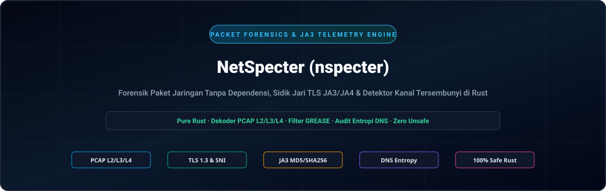
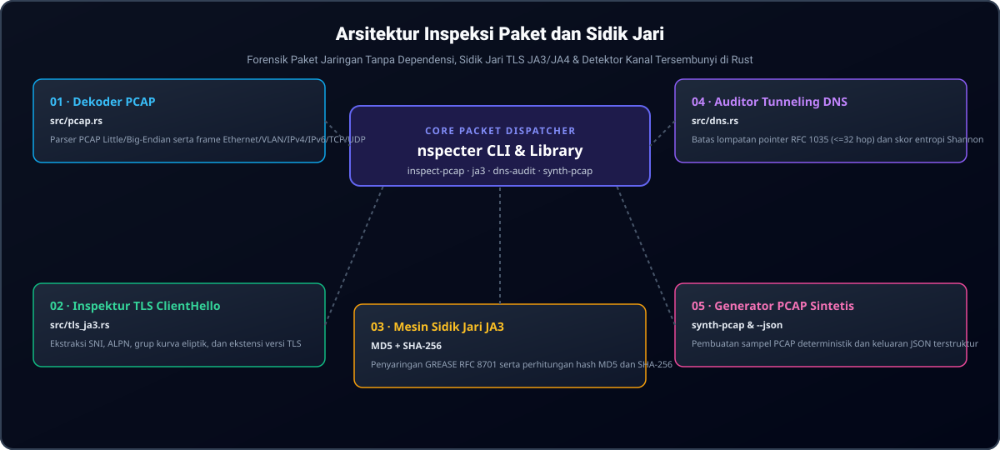

<div align="center">

<p align="center">
  <a href="../../README.md">🇺🇸 English</a> · <a href="./ko.md">🇰🇷 한국어</a> · <a href="./zh-CN.md">🇨🇳 中文</a> · <a href="./es.md">🇪🇸 Español</a> · <a href="./hi.md">🇮🇳 हिन्दी</a><br />
  <a href="./ar.md">🇸🇦 العربية</a> · <a href="./pt-BR.md">🇧🇷 Português</a> · <a href="./ru.md">🇷🇺 Русский</a> · <a href="./fr.md">🇫🇷 Français</a> · <strong>🇮🇩 Bahasa Indonesia</strong>
</p>

<p align="center">
  
</p>

# NetSpecter (nspecter)

**Mesin forensik paket jaringan, sidik jari kriptografi TLS JA3/JA4, dan pendeteksi saluran tersembunyi murni berbahasa Rust tanpa dependensi C eksternal**

[](https://github.com/GHSFS/net-specter/actions/workflows/ci.yml)
[](../../LICENSE)
[](../../Cargo.toml)
[](../../SECURITY.md)

</div>

---

## 🛡️ Gambaran Umum dan Kemampuan Inti

<details open>
<summary><b>🛡️ Gambaran Umum dan Kemampuan Inti</b></summary>
<br>

net-specter (nspecter) adalah utilitas baris perintah dan pustaka Rust murni yang sangat cepat dan aman dari kebocoran memori, dirancang untuk forensik paket jaringan luring, ekstraksi sidik jari kriptografi jabat tangan (handshake), dan pendeteksian terowongan tersembunyi tanpa dependensi libpcap atau pengikat C eksternal.

1. **Mesin Penangkapan PCAP & PCAPNG Tanpa Dependensi (`src/pcap.rs` & `src/pcapng.rs`)** — Mendekode berkas libpcap `.pcap` klasik dalam format little-endian dan big-endian dengan stempel waktu mikrodetik dan nanodetik (`0xA1B2C3D4`, `0xA1B23C4D`), bingkai Ethernet II (dengan pembongkaran tag VLAN IEEE 802.1Q), tangkapan Raw IP (`linktype 101`), tajuk IPv4/IPv6, dan segmen transport TCP/UDP. Mendukung penuh blok tajuk bagian generasi berikutnya `.pcapng` (SHB `0x0A0D0D0A`), blok deskripsi antarmuka (IDB), blok paket yang disempurnakan (EPB), dan blok paket sederhana (SPB) dengan resolusi waktu arbitrer.
2. **Inspektur Mendalam TLS `ClientHello` & Mesin JA3 (`src/tls_ja3.rs`)** — Mengurai rekaman jabat tangan TLS (`0x16`) `ClientHello` (`0x01`), mengekstrak nama host SNI (`0x0000`), kelompok kurva yang didukung (`0x000a`), format titik EC (`0x000b`), protokol ALPN (`0x0010`), dan versi yang didukung (`0x002b`). Menyaring nilai GREASE RFC 8701 (`0x?a?a`) secara otomatis serta menghitung intisari sidik jari **JA3 MD5** dan **SHA-256**.
3. **Pengurai Format Kawat DNS & Auditor Terowongan Tersembunyi (`src/dns.rs`)** — Mendekode paket DNS RFC 1035 dengan perlindungan ketat terhadap loop penunjuk terkompresi (`<= 32` lompatan) serta menilai entropi Shannon subdomain, panjang label, dan kepadatan muatan heksadesimal/Base32 untuk menandai saluran C2 tersembunyi atau penyelundupan data (`Low`, `Elevated`, `High`).
4. **Laboratorium Sintesis Paket Deterministik (`nspecter synth-pcap`)** — Menghasilkan tangkapan mandiri multi-paket `.pcap` dan `.pcapng` yang berisi TLS 1.3 `ClientHello` dan kueri DNS normal atau tersembunyi untuk pengujian CI otomatis yang dapat direproduksi dan validasi analis.
5. **Mesin Sidik Jari TLS / QUIC Modern JA4 & JA4S (`src/ja4.rs`)** — Menghasilkan sidik jari klien JA4 terurut yang kompatibel dengan FoxIO (`t13d1516h2_<cipher_hash>_<ext_hash>`) dan sidik jari respons server JA4S yang kebal terhadap pengacakan urutan ekstensi TLS di seluruh transportasi TCP, QUIC, dan DTLS.
6. **Perakitan Ulang Aliran TCP & Pelacak Segmen di Luar Urutan (`src/tcp_stream.rs`)** — Merekonstruksi aliran byte TCP dua arah pada segmen yang terfragmentasi, dikirim ulang, dan tidak berurutan dengan penanganan perputaran urutan 32-bit RFC 793, batas memori anti-serangan DoS, dan inspeksi protokol aplikasi multi-segmen (TLS JA3/JA4, HTTP/1.1, HTTP/2, SSH).
7. **Inspektur Bingkai HTTP/1.1 & HTTP/2 serta Sidik Jari JA4H (`src/http_inspect.rs`)** — Mengurai permintaan dan tanggapan HTTP/1.1, mendekode mukadimah koneksi HTTP/2, aliran bingkai biner, dan parameter `SETTINGS`, serta menghitung sidik jari klien `JA4H` yang patuh pada standar FoxIO (`nspecter http-audit`).
8. **Analisis Forensik ServerHello JA3S & Rantai Sertifikat X.509 (`src/tls_cert.rs`)** — Mengekstrak sidik jari respons server JA3S (MD5 dan SHA-256 dengan kekebalan terhadap GREASE RFC 8701), mendekode pesan `Certificate` (`0x0b`) TLS 1.2 dan 1.3; menyediakan pengurai ASN.1 DER mandiri untuk sertifikat X.509 dan mendeteksi anomali sertifikat (kedaluwarsa, belum berlaku, tanggal terbalik, algoritma tanda tangan lemah, ditandatangani sendiri) pada tangkapan PCAP, PCAPNG, dan aliran TCP yang dirakit ulang (`nspecter cert-audit`).
9. **Dekriptor Paket Awal QUIC & RFC 9001 (`src/quic.rs`, `src/quic_crypto.rs`)** — Menurunkan kunci awal melalui HKDF-SHA256, membuka topeng perlindungan tajuk RFC 9001, mendekripsi paket QUIC Initial menggunakan AES-128-GCM murni berbahasa Rust, merakit kembali bingkai CRYPTO, dan mengekstrak sidik jari TLS 1.3 JA3/JA4 di atas UDP/443 (`nspecter quic-audit`).
10. **Pendeteksi Variasi (Jitter) Sinyal Suar C2 & Spektrogram Interval Berkala (`src/beacon.rs`)** — Menganalisis jeda waktu antar kedatangan paket ($Delta t$), variasi rata-rata/varians/median, koefisien variasi ($CV$), spektrogram frekuensi interval, dan skor periodisitas untuk mengklasifikasikan detak jantung otomatis C2 (`HighConfidenceBeacon`, `JitteredBeacon`, `SuspectInterval`, `Benign`) dalam PCAP dan PCAPNG (`nspecter beacon-audit`).
11. **Mesin Evaluasi Ekspresi Penyaring Gaya BPF (`src/filter/`)** — Mengevaluasi ekspresi penyaring paket terhadap blok CIDR IPv4/IPv6, rentang port, protokol transportasi, masker bendera TCP, dan panjang bingkai (`nspecter filter`).
12. **Sidik Jari Pertukaran Kunci SSH HASSH Klien & Server (`src/ssh_hassh.rs`)** — Mengurai spanduk identifikasi RFC 4253 dan paket `SSH_MSG_KEXINIT`, menghitung sidik jari MD5 dan SHA-256 Salesforce `HASSH` dan `HASSHServer` pada tangkapan PCAP, PCAPNG, dan aliran byte mentah (`nspecter hassh`).

</details>

---

## 🏛️ Arsitektur Inspeksi Paket dan Sidik Jari Kriptografi

<details open>
<summary><b>🏛️ Arsitektur Inspeksi Paket dan Sidik Jari Kriptografi</b></summary>
<br>

<p align="center">
  
</p>

| # | Komponen | Modul | Tanggung Jawab Utama |
|---|---|---|---|
| **01** | **01 · Dekoder Kawat PCAP** | `src/pcap.rs` | Pengurai libpcap mikro/nanodetik little/big-endian dan pendekodean Ethernet/VLAN/IPv4/IPv6/TCP/UDP |
| **02** | **02 · Inspektur TLS ClientHello** | `src/tls_ja3.rs` | Ekstraksi tanpa salin untuk SNI, ALPN, kelompok kurva yang didukung, format EC, dan versi |
| **03** | **03 · Sidik Jari Kriptografi JA3** | `MD5 + SHA-256` | Penyaringan GREASE RFC 8701, pembuatan string kanonik JA3, dan kalkulasi intisari ganda |
| **04** | **04 · Auditor Terowongan DNS** | `src/dns.rs` | Perlindungan loop penunjuk RFC 1035 (<=32 lompatan) dan penilaian C2 berbasis entropi Shannon |
| **05** | **05 · Laboratorium Sintesis Paket** | `synth-pcap & --json` | Generator deterministik PCAP multi-paket dan keluaran telemetri terstruktur dalam JSON |

</details>

---

## 🚀 Panduan Memulai Cepat dan Perintah CLI

<details open>
<summary><b>🚀 Panduan Memulai Cepat dan Perintah CLI</b></summary>
<br>

```bash
# 1. Kompilasi biner rilis teroptimasi
cargo build --release

# 2. Hasilkan berkas tangkapan sampel deterministik dalam format .pcap atau .pcapng (TLS 1.3 ClientHello + paket DNS)
./target/release/nspecter synth-pcap sample.pcap
./target/release/nspecter synth-pcap sample.pcapng --pcapng

# 3. Periksa semua aliran, jabat tangan TLS JA3, dan kueri DNS dalam tangkapan (.pcap atau .pcapng)
./target/release/nspecter inspect-pcap sample.pcap
./target/release/nspecter inspect-pcap sample.pcapng --json

# 4. Ekstrak rincian TLS ClientHello dan intisari JA3 MD5 / SHA-256 dari tangkapan atau string heksadesimal
./target/release/nspecter ja3 sample.pcapng --json

# 5. Ekstrak sidik jari klien FoxIO JA4 dan server JA4S dari tangkapan atau string heksadesimal
./target/release/nspecter ja4 sample.pcapng --json

# 6. Audit paket DNS untuk mendeteksi terowongan tersembunyi berentropi tinggi dan eksfiltrasi C2
./target/release/nspecter dns-audit sample.pcapng --json

# 7. Rakit kembali aliran TCP dua arah dan periksa muatan data aplikasi
./target/release/nspecter tcp-stream sample.pcapng --json

# 8. Periksa bingkai HTTP/1.1 dan HTTP/2 serta hitung sidik jari klien HTTP JA4H
./target/release/nspecter http-audit capture.pcap --json

# 9. Lakukan audit forensik sidik jari TLS ServerHello JA3S dan rantai sertifikat X.509
./target/release/nspecter cert-audit capture.pcap --json

# 10. Dekripsi paket awal QUIC dan ekstrak sidik jari TLS 1.3 JA3/JA4
./target/release/nspecter quic-audit capture.pcap --json

# 11. Audit variasi (jitter) sinyal suar C2 dan spektrogram interval berkala
./target/release/nspecter beacon-audit capture.pcap --min-events 4 --json

# 12. Saring bingkai tangkapan menggunakan ekspresi bergaya BPF
./target/release/nspecter filter capture.pcap "tcp port 443" --json

# 13. Ekstrak spanduk SSH, urai negosiasi KEXINIT, dan hitung sidik jari Salesforce HASSH
./target/release/nspecter hassh capture.pcap --json

# 14. Audit aliran ICMP Echo Request/Reply untuk mendeteksi terowongan dan perusakan muatan data
./target/release/nspecter icmp-tunnel capture.pcap --dump-payload --json

# 15. Identifikasi sistem operasi secara pasif dari paket TCP SYN (p0f v3 dan FoxIO JA4T)
./target/release/nspecter os-fp capture.pcap --json

# 16. Audit permintaan dan tanggapan ARP untuk mendeteksi spoofing, banjir gratifikasi, dan anomali MITM L2
./target/release/nspecter arp-audit capture.pcap --gateway 192.168.1.1 --json
```

</details>

---

## 📦 Referensi Modul dan Sub-Perintah

<details open>
<summary><b>📦 Referensi Modul dan Sub-Perintah</b></summary>
<br>

```text
net-specter/
├── Cargo.toml                     # Manifes crate (pustaka net-specter dan biner nspecter)
├── README.md                      # Dokumentasi utama dalam bahasa Inggris
├── ROADMAP.md                     # Fitur yang telah selesai dan peta jalan pengembangan masa depan
├── CHANGELOG.md                   # Riwayat rilis versi
├── SECURITY.md                    # Keamanan memori dan kebijakan pelaporan kerentanan
├── LICENSE                        # Lisensi Apache-2.0
├── NOTICE                         # Pemberitahuan atribusi dan hak cipta (GHSFS)
├── src/
│   ├── lib.rs                     # Ekspor antarmuka pustaka publik
│   ├── main.rs                    # Titik masuk utama CLI (dispatcher ringkas <25 baris)
│   ├── cli.rs                     # Definisi sub-perintah dan argumen Clap
│   ├── error.rs                   # Model kesalahan terpadu SpecterError dan Result<T>
│   ├── commands/                  # Penangan modular perintah CLI (arp, inspect, tls, dns, tcp, http, cert, quic, synth, beacon, filter, hassh, icmp, os_fp)
│   ├── filter/                    # Pengurai dan pengevaluasi ekspresi penyaring bergaya BPF
│   ├── arp_audit.rs               # Pendeteksi pemalsuan ARP RFC 826 / RFC 5227 dan MITM Layer-2
│   ├── p0f/                       # Mesin sidik jari pasif OS dan FoxIO JA4T/JA4TS
│   ├── icmp_tunnel.rs             # Pendeteksi terowongan tersembunyi ICMP Echo dan perusakan data
│   ├── beacon.rs                  # Pendeteksi variasi suar C2 dan spektrogram interval
│   ├── pcap.rs                    # Dekoder libpcap .pcap, pengurai L2/L3/L4 dan generator
│   ├── pcapng.rs                  # Pengurai blok struktur PCAPNG (SHB/IDB/EPB/SPB) dan generator
│   ├── quic.rs                    # Pengekstrak paket QUIC Initial dan aliran CRYPTO
│   ├── quic_crypto.rs             # Dekriptor HKDF-SHA256, AES-128 dan GCM murni berbahasa Rust
│   ├── ssh_hassh.rs               # Spanduk identifikasi SSH-2.0 dan mesin Salesforce HASSH/HASSHServer
│   ├── tls_ja3.rs                 # Pengurai TLS ClientHello, penyaring GREASE dan mesin JA3
│   ├── tls_cert.rs                # TLS ServerHello JA3S, sertifikat TLS 1.2/1.3 dan pengurai ASN.1 X.509
│   ├── ja4.rs                     # Mesin sidik jari modern FoxIO JA4 klien dan JA4S server
│   ├── tcp_stream.rs              # Perakitan ulang aliran TCP dan pelacak segmen tidak berurutan
│   ├── http_inspect.rs            # Pengurai HTTP/1.1, bingkai HTTP/2 SETTINGS dan mesin JA4H
│   └── dns.rs                     # Dekoder DNS RFC 1035 dan auditor terowongan berbasis entropi Shannon
└── tests/
    ├── arp_audit_test.rs          # Pengujian integrasi spoofing ARP, ketidakstabilan gateway, dan banjir ARP
    ├── p0f_test.rs                # Pengujian sidik jari pasif OS melalui TCP SYN dan FoxIO JA4T
    ├── icmp_tunnel_test.rs        # Pengujian integrasi terowongan tersembunyi ICMP dan entropi Shannon
    ├── beacon_test.rs             # Pengujian analisis variasi suar C2, spektrogram, dan klasifikasi
    ├── filter_test.rs             # Pengujian evaluasi ekspresi penyaring paket bergaya BPF
    ├── pcap_tls_test.rs           # Pengujian integrasi PCAP, L2-L4, penyaringan GREASE, dan JA3
    ├── pcapng_test.rs             # Pengujian blok PCAPNG, stempel waktu nanodetik, dan perintah CLI
    ├── ja4_test.rs                # Pengujian sidik jari JA4/JA4S, paket QUIC Initial, dan kekebalan GREASE
    ├── quic_test.rs               # Pengujian derivasi kunci HKDF RFC 9001, AES-GCM, dan dekripsi QUIC
    ├── ssh_hassh_test.rs          # Pengujian spanduk SSH, negosiasi KEXINIT, dan Salesforce HASSH
    ├── tcp_stream_test.rs         # Pengujian perakitan aliran TCP dan muatan data TLS multi-segmen
    ├── http_inspect_test.rs       # Pengujian bingkai HTTP/1.1, HTTP/2 dan sidik jari JA4H
    ├── tls_cert_test.rs           # Pengujian ServerHello JA3S, ASN.1 DER X.509, dan deteksi anomali
    └── dns_audit_test.rs          # Pengujian pertahanan loop kompresi DNS dan deteksi terowongan
```

Konsultasikan [ROADMAP.md](../../ROADMAP.md) untuk melihat kapabilitas forensik jaringan dan protokol yang direncanakan.

</details>

---

## 🔒 Keamanan Memori dan Ketahanan Pengurai

<details open>
<summary><b>🔒 Keamanan Memori dan Ketahanan Pengurai</b></summary>
<br>

- **100% Rust Aman**: Nol blok `unsafe` di seluruh modul pendekodean bingkai biner.
- **Pertahanan Loop Kompresi RFC 1035**: Dekompresi nama DNS memberlakukan batas ketat maksimum 32 lompatan penunjuk dan langsung menolak penunjuk maju atau referensi diri.
- **Pembersihan Aman Buffer Sensitif**: Buffer sementara berisi data acak TLS, ID sesi, dan byte perakitan ulang dihapus secara aman saat dibatalkan melalui `zeroize`.
- **Penyanggaan Segmen Tahan Serangan DoS**: Antrean segmen TCP yang tidak berurutan menerapkan kuota memori tetap per aliran untuk mencegah kehabisan sumber daya akibat banjir fragmen.
- **Kebijakan Keamanan dan Pelaporan Kerentanan**: Lihat [SECURITY.md](../../SECURITY.md).

</details>

---

## 📄 Lisensi dan Atribusi

<details open>
<summary><b>📄 Lisensi dan Atribusi</b></summary>
<br>

```text
Copyright 2026 GHSFS

Licensed under the Apache License, Version 2.0 (the "License");
you may not use this file except in compliance with the License.
You may obtain a copy of the License at

    http://www.apache.org/licenses/LICENSE-2.0
```

</details>
