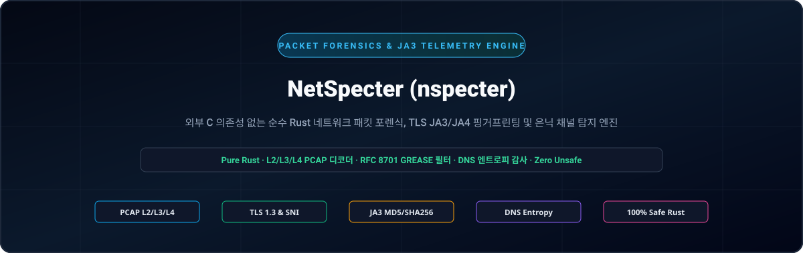
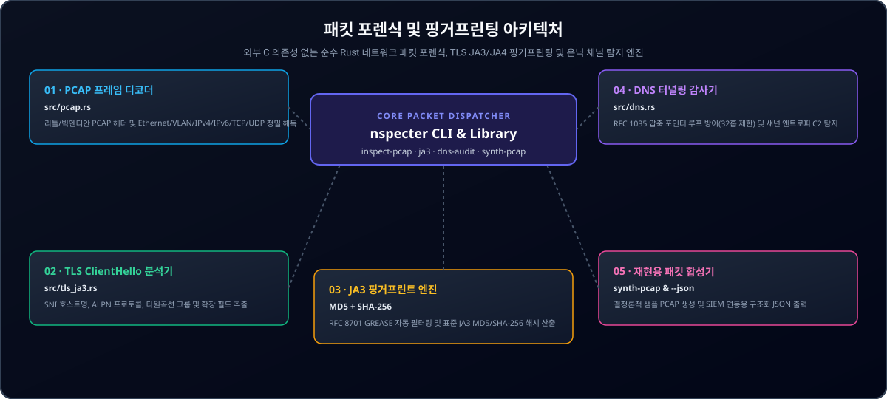

<div align="center">

<p align="center">
  <a href="../../README.md">🇺🇸 English</a> · <strong>🇰🇷 한국어</strong> · <a href="./zh-CN.md">🇨🇳 中文</a> · <a href="./es.md">🇪🇸 Español</a> · <a href="./hi.md">🇮🇳 हिन्दी</a><br />
  <a href="./ar.md">🇸🇦 العربية</a> · <a href="./pt-BR.md">🇧🇷 Português</a> · <a href="./ru.md">🇷🇺 Русский</a> · <a href="./fr.md">🇫🇷 Français</a> · <a href="./id.md">🇮🇩 Bahasa Indonesia</a>
</p>

<p align="center">
  
</p>

# NetSpecter (nspecter)

**외부 C 의존성 없는 순수 Rust 네트워크 패킷 포렌식, TLS JA3/JA4 핑거프린팅 및 은닉 채널 탐지 엔진**

[](https://github.com/GHSFS/net-specter/actions/workflows/ci.yml)
[](../../LICENSE)
[](./Cargo.toml)
[](../../SECURITY.md)

---

## 🛡️ 개요 및 핵심 기능

<details open>
<summary><b>🛡️ 개요 및 핵심 기능</b></summary>
<br>

net-specter (nspecter)는 외부 C 라이브러리(libpcap 등) 의존성 없이 순수 Rust로 구현된 오프라인 패킷 포렌식, TLS 암호화 핸드셰이크 핑거프린팅 및 DNS 은닉 터널링 탐지 CLI 도구이자 라이브러리입니다.

1. **Zero-Dependency PCAP & PCAPNG Capture Engine (`src/pcap.rs` & `src/pcapng.rs`)** — Decodes classic libpcap `.pcap` files across both little-endian and big-endian microsecond/nanosecond headers (`0xA1B2C3D4`, `0xA1B23C4D`), Ethernet II frames (with IEEE 802.1Q VLAN tag unwrapping), Raw IP captures (`linktype 101`), IPv4/IPv6 headers, and TCP/UDP transport segments, as well as next-generation `.pcapng` Section Header Blocks (`0x0A0D0D0A`), Interface Description Blocks, Enhanced Packet Blocks, and Simple Packet Blocks with arbitrary timestamp resolution.
2. **TLS `ClientHello` Deep Inspector & JA3 Engine (`src/tls_ja3.rs`)** — Parses TLS Handshake (`0x16`) `ClientHello` (`0x01`) records, extracts SNI hostnames (`0x0000`), Supported Groups (`0x000a`), EC Point Formats (`0x000b`), ALPN protocols (`0x0010`), and Supported Versions (`0x002b`), filters RFC 8701 GREASE values (`0x?a?a`), and computes both **JA3 MD5** and **SHA-256** fingerprints.
3. **DNS Wire-Format Parser & Covert Tunneling Auditor (`src/dns.rs`)** — Decodes RFC 1035 DNS packets with strict compression pointer loop protection (`<= 32` hops) and scores subdomain Shannon entropy, label lengths, and hexadecimal/Base32 payload density to flag covert C2 or data exfiltration channels (`Low`, `Elevated`, `High`).
4. **Deterministic Capture Synthesis (`nspecter synth-pcap`)** — Generates self-contained multi-packet `.pcap` and `.pcapng` captures containing TLS 1.3 `ClientHello` and benign/covert DNS queries for reproducible CI testing and analyst validation.
5. **JA4 & JA4S Modern TLS / QUIC Fingerprinting Engine (`src/ja4.rs`)** — Computes FoxIO-compatible sorted JA4 client fingerprints (`t13d1516h2_<cipher_hash>_<ext_hash>`) and JA4S server response fingerprints resilient to TLS extension order randomization across TCP, QUIC, and DTLS transports.

</details>

---

## 🏛️ 패킷 포렌식 및 핑거프린팅 아키텍처

<details open>
<summary><b>🏛️ 패킷 포렌식 및 핑거프린팅 아키텍처</b></summary>
<br>

<p align="center">
  
</p>

| # | Component | Module | Responsibility |
|---|---|---|---|
| **01** | **01 · PCAP 프레임 디코더** | `src/pcap.rs` | 리틀/빅엔디안 PCAP 헤더 및 Ethernet/VLAN/IPv4/IPv6/TCP/UDP 정밀 해독 |
| **02** | **02 · TLS ClientHello 분석기** | `src/tls_ja3.rs` | SNI 호스트명, ALPN 프로토콜, 타원곡선 그룹 및 확장 필드 추출 |
| **03** | **03 · JA3 핑거프린트 엔진** | `MD5 + SHA-256` | RFC 8701 GREASE 자동 필터링 및 표준 JA3 MD5/SHA-256 해시 산출 |
| **04** | **04 · DNS 터널링 감사기** | `src/dns.rs` | RFC 1035 압축 포인터 루프 방어(32홉 제한) 및 섀넌 엔트로피 C2 탐지 |
| **05** | **05 · 재현용 패킷 합성기** | `synth-pcap & --json` | 결정론적 샘플 PCAP 생성 및 SIEM 연동용 구조화 JSON 출력 |

</details>

---

## 🚀 빠른 시작 및 CLI 사용법

<details open>
<summary><b>🚀 빠른 시작 및 CLI 사용법</b></summary>
<br>

```bash
# 1. Build the release binary
cargo build --release

# 2. Generate a deterministic sample .pcap or .pcapng capture (TLS 1.3 ClientHello + DNS packets)
./target/release/nspecter synth-pcap sample.pcap
./target/release/nspecter synth-pcap sample.pcapng --pcapng

# 3. Inspect all flows, TLS JA3 handshakes, and DNS queries in a capture (.pcap or .pcapng)
./target/release/nspecter inspect-pcap sample.pcap
./target/release/nspecter inspect-pcap sample.pcapng --json

# 4. Extract TLS ClientHello details and JA3 MD5 / SHA-256 digests from a capture or hex string
./target/release/nspecter ja3 sample.pcapng --json

# 5. Extract FoxIO JA4 client and JA4S server fingerprints from a capture or hex string
./target/release/nspecter ja4 sample.pcapng --json

# 6. Audit DNS packets for high-entropy covert tunneling / C2 exfiltration
./target/release/nspecter dns-audit sample.pcapng --json
```

</details>

---

## 📦 모듈 및 서브커맨드 명세

<details open>
<summary><b>📦 모듈 및 서브커맨드 명세</b></summary>
<br>

```text
net-specter/
├── Cargo.toml                     # Crate manifest (net-specter / nspecter binary)
├── README.md                      # Primary English documentation
├── ROADMAP.md                     # Shipped capabilities & upcoming milestones
├── CHANGELOG.md                   # Release history
├── SECURITY.md                    # Memory safety & parser security policy
├── LICENSE                        # Apache-2.0 License
├── NOTICE                         # Attribution notice (GHSFS)
├── src/
│   ├── lib.rs                     # Public library exports
│   ├── main.rs                    # CLI entrypoint & output formatter
│   ├── cli.rs                     # Clap subcommand definitions
│   ├── error.rs                   # Unified SpecterError & Result<T>
│   ├── pcap.rs                    # Libpcap .pcap decoder, L2/L3/L4 parser & generator
│   ├── pcapng.rs                  # PCAPNG block parser (SHB/IDB/EPB/SPB) & generator
│   ├── tls_ja3.rs                 # TLS ClientHello parser, GREASE filter & JA3 engine
│   ├── ja4.rs                     # Modern FoxIO JA4 client & JA4S server fingerprint engine
│   └── dns.rs                     # RFC 1035 DNS decoder & Shannon entropy tunnel auditor
└── tests/
    ├── pcap_tls_test.rs           # PCAP, L2/L3/L4, GREASE & JA3 integration tests
    ├── pcapng_test.rs             # PCAPNG blocks, nanosecond timing & CLI integration tests
    ├── ja4_test.rs                # JA4/JA4S, QUIC Initial & GREASE immunity integration tests
    └── dns_audit_test.rs          # DNS compression loop & covert tunnel integration tests
```

See [ROADMAP.md](../../ROADMAP.md) for planned JA4/JA4S, QUIC Initial decryption, and TCP stream reassembly capabilities.

</details>

---

## 🔒 메모리 안전성 및 파서 보안 설계

<details open>
<summary><b>🔒 메모리 안전성 및 파서 보안 설계</b></summary>
<br>

- **100% Safe Rust**: Zero `unsafe` blocks across all binary frame decoders.
- **RFC 1035 Compression Loop Defense**: DNS name decompression enforces a strict 32-hop pointer ceiling and forward/self-pointer rejection.
- **Transient Buffer Zeroization**: Ephemeral TLS random and session ID byte buffers are wiped on drop via `zeroize`.
- **Policy & Vulnerability Reporting**: Refer to [SECURITY.md](../../SECURITY.md).

</details>

---

## 📄 라이선스 및 저작권 안내

<details open>
<summary><b>📄 라이선스 및 저작권 안내</b></summary>
<br>

```text
Copyright 2026 GHSFS

Licensed under the Apache License, Version 2.0 (the "License");
you may not use this file except in compliance with the License.
You may obtain a copy of the License at

    http://www.apache.org/licenses/LICENSE-2.0
```

</details>
