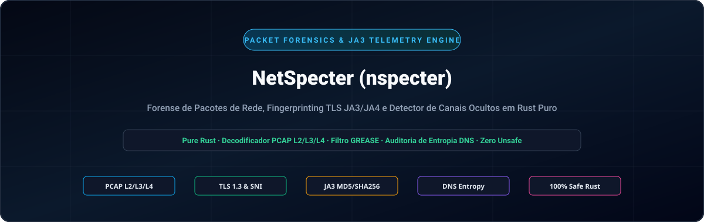
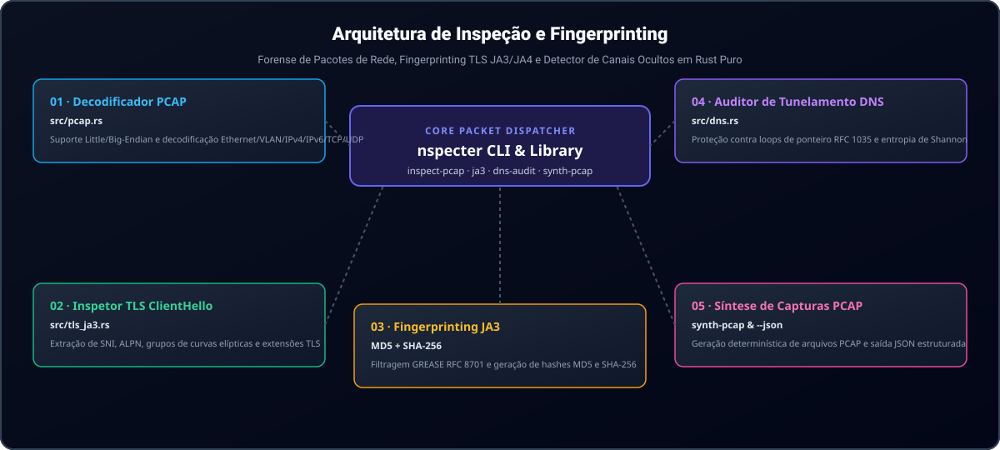

<div align="center">

<p align="center">
  <a href="../../README.md">🇺🇸 English</a> · <a href="./ko.md">🇰🇷 한국어</a> · <a href="./zh-CN.md">🇨🇳 中文</a> · <a href="./es.md">🇪🇸 Español</a> · <a href="./hi.md">🇮🇳 हिन्दी</a><br />
  <a href="./ar.md">🇸🇦 العربية</a> · <strong>🇧🇷 Português</strong> · <a href="./ru.md">🇷🇺 Русский</a> · <a href="./fr.md">🇫🇷 Français</a> · <a href="./id.md">🇮🇩 Bahasa Indonesia</a>
</p>

<p align="center">
  
</p>

# NetSpecter (nspecter)

**Motor em Rust puro sem dependências externas de C para perícia de pacotes de rede, impressões digitais TLS JA3/JA4 e detecção de canais ocultos**

[](https://github.com/GHSFS/net-specter/actions/workflows/ci.yml)
[](../../LICENSE)
[](../../Cargo.toml)
[](../../SECURITY.md)

</div>

---

## 🛡️ Visão geral e recursos principais

<details open>
<summary><b>🛡️ Visão geral e recursos principais</b></summary>
<br>

net-specter (nspecter) é um utilitário de linha de comando e biblioteca em Rust puro, rápido e seguro em memória, projetado para análise forense offline de pacotes de rede, extração de impressões digitais criptográficas e detecção de túneis ocultos sem dependências externas de libpcap ou vínculos C.

1. **Motor de captura PCAP e PCAPNG sem dependências (`src/pcap.rs` e `src/pcapng.rs`)** — Decodifica arquivos clássicos libpcap `.pcap` nos formatos little-endian e big-endian com carimbos de data/hora em microssegundos e nanossegundos (`0xA1B2C3D4`, `0xA1B23C4D`), quadros Ethernet II (com desenrolamento de tags VLAN IEEE 802.1Q), capturas Raw IP (`linktype 101`), cabeçalhos IPv4/IPv6 e segmentos de transporte TCP/UDP. Suporta blocos de cabeçalho de seção `.pcapng` de última geração (SHB, `0x0A0D0D0A`), blocos de descrição de interface (IDB), blocos de pacotes aprimorados (EPB) e blocos de pacotes simples (SPB) com resolução de tempo arbitrária.
2. **Inspetor profundo de TLS `ClientHello` e motor JA3 (`src/tls_ja3.rs`)** — Analisa registros de handshake TLS (`0x16`) `ClientHello` (`0x01`), extraindo nomes de host SNI (`0x0000`), grupos suportados (`0x000a`), formatos de ponto EC (`0x000b`), protocolos ALPN (`0x0010`) e versões suportadas (`0x002b`). Filtra automaticamente valores GREASE da RFC 8701 (`0x?a?a`) e gera resumos **JA3 MD5** e **SHA-256**.
3. **Analisador de formato de transmissão DNS e auditor de túneis ocultos (`src/dns.rs`)** — Decodifica pacotes DNS RFC 1035 com proteção rigorosa contra loops de ponteiros comprimidos (`<= 32` saltos) e calcula a entropia de Shannon de subdomínios, comprimentos de rótulos e densidade de carga hexadecimal/Base32 para sinalizar canais de C2 ou exfiltração de dados (`Low`, `Elevated`, `High`).
4. **Laboratório de síntese determinística de pacotes (`nspecter synth-pcap`)** — Gera capturas multipacote autocontidas em `.pcap` e `.pcapng` contendo registros TLS 1.3 `ClientHello` e consultas DNS legítimas ou ocultas para testes de CI reproduzíveis e validação pericial.
5. **Motor de impressões digitais modernas TLS / QUIC JA4 e JA4S (`src/ja4.rs`)** — Computa impressões digitais de cliente JA4 ordenadas e compatíveis com FoxIO (`t13d1516h2_<cipher_hash>_<ext_hash>`) e respostas de servidor JA4S imunes à aleatorização da ordem de extensões TLS em transportes TCP, QUIC e DTLS.
6. **Reagrupamento de fluxos TCP e rastreador de segmentos fora de ordem (`src/tcp_stream.rs`)** — Reconstrói fluxos bidirecionais de bytes TCP através de segmentos fragmentados, retransmitidos e fora de ordem com manipulação de sequência de 32 bits RFC 793, cotas de memória contra DoS e inspeção profunda de protocolos de aplicação (TLS JA3/JA4, HTTP/1.1, HTTP/2, SSH).
7. **Inspetor de quadros HTTP/1.1 e HTTP/2 e impressões JA4H (`src/http_inspect.rs`)** — Analisa requisições e respostas HTTP/1.1, decodifica preâmbulos de conexão HTTP/2, fluxos de quadros binários e parâmetros `SETTINGS`, calculando impressões digitais de cliente `JA4H` compatíveis com FoxIO (`nspecter http-audit`).
8. **Análise forense de ServerHello JA3S e cadeia de certificados X.509 (`src/tls_cert.rs`)** — Extrai impressões digitais de resposta de servidor JA3S (MD5 e SHA-256 com imunidade GREASE RFC 8701), decodifica mensagens `Certificate` (`0x0b`) em TLS 1.2 e 1.3; fornece um analisador ASN.1 DER independente para certificados X.509 e identifica anomalias de certificados (expirados, ainda não válidos, datas invertidas, assinaturas fracas, autoassinados) em PCAP, PCAPNG e fluxos TCP reagrupados (`nspecter cert-audit`).
9. **Descriptografador de pacotes iniciais QUIC e RFC 9001 (`src/quic.rs`, `src/quic_crypto.rs`)** — Deriva chaves iniciais via HKDF-SHA256, remove a máscara de proteção de cabeçalho RFC 9001, descriptografa pacotes QUIC Initial com AES-128-GCM em Rust puro, remonta quadros CRYPTO e extrai impressões TLS 1.3 JA3/JA4 sobre UDP/443 (`nspecter quic-audit`).
10. **Detector de variação (Jitter) de beacons C2 e espectrogramas de intervalos (`src/beacon.rs`)** — Analisa deltas de tempo entre chegadas ($Delta t$), variação média/variância/mediana, coeficiente de variação ($CV$), espectrogramas de frequência de intervalos e pontuações de periodicidade para classificar batimentos cardíacos automatizados de C2 (`HighConfidenceBeacon`, `JitteredBeacon`, `SuspectInterval`, `Benign`) em PCAP e PCAPNG (`nspecter beacon-audit`).
11. **Motor de expressões de filtragem no estilo BPF (`src/filter/`)** — Avalia expressões de filtragem contra blocos CIDR IPv4/IPv6, faixas de portas, protocolos de transporte, máscaras de sinalizadores TCP e comprimentos de quadros (`nspecter filter`).
12. **Impressões digitais de troca de chaves SSH HASSH para cliente e servidor (`src/ssh_hassh.rs`)** — Analisa banners de identificação RFC 4253 e pacotes `SSH_MSG_KEXINIT`, calculando impressões MD5 e SHA-256 Salesforce `HASSH` e `HASSHServer` em capturas PCAP, PCAPNG e fluxos binários brutos (`nspecter hassh`).

</details>

---

## 🏛️ Arquitetura de inspeção de pacotes e impressões digitais

<details open>
<summary><b>🏛️ Arquitetura de inspeção de pacotes e impressões digitais</b></summary>
<br>

<p align="center">
  
</p>

| # | Componente | Módulo | Responsabilidade principal |
|---|---|---|---|
| **01** | **01 · Decodificador de rede PCAP** | `src/pcap.rs` | Analisador libpcap em microssegundos/nanossegundos little/big-endian e decodificação Ethernet/VLAN/IPv4/IPv6/TCP/UDP |
| **02** | **02 · Inspetor de TLS ClientHello** | `src/tls_ja3.rs` | Extração zero-copy de SNI, ALPN, grupos suportados, formatos EC e versões |
| **03** | **03 · Impressão digital JA3** | `MD5 + SHA-256` | Filtragem de GREASE RFC 8701, geração de strings canônicas JA3 e resumos duplos |
| **04** | **04 · Auditor de túneis DNS** | `src/dns.rs` | Proteção contra loops de ponteiros RFC 1035 (<=32 saltos) e pontuação de C2 por entropia de Shannon |
| **05** | **05 · Laboratório de síntese de pacotes** | `synth-pcap & --json` | Gerador determinístico de PCAP multipacote e telemetria estruturada em JSON |

</details>

---

## 🚀 Início rápido e uso da linha de comando

<details open>
<summary><b>🚀 Início rápido e uso da linha de comando</b></summary>
<br>

```bash
# 1. Compilar o binário otimizado para produção
cargo build --release

# 2. Gerar uma captura de amostra determinística em formato .pcap ou .pcapng (TLS 1.3 ClientHello + pacotes DNS)
./target/release/nspecter synth-pcap sample.pcap
./target/release/nspecter synth-pcap sample.pcapng --pcapng

# 3. Inspecionar todos os fluxos, handshakes TLS JA3 e consultas DNS em uma captura (.pcap ou .pcapng)
./target/release/nspecter inspect-pcap sample.pcap
./target/release/nspecter inspect-pcap sample.pcapng --json

# 4. Extrair detalhes de TLS ClientHello e resumos JA3 MD5 / SHA-256 de uma captura ou string hexadecimal
./target/release/nspecter ja3 sample.pcapng --json

# 5. Extrair impressões digitais de cliente FoxIO JA4 e servidor JA4S de uma captura ou string hexadecimal
./target/release/nspecter ja4 sample.pcapng --json

# 6. Auditar pacotes DNS em busca de túneis ocultos de alta entropia e exfiltração de dados C2
./target/release/nspecter dns-audit sample.pcapng --json

# 7. Remontar fluxos TCP bidirecionais e inspecionar cargas úteis de aplicação
./target/release/nspecter tcp-stream sample.pcapng --json

# 8. Inspecionar quadros HTTP/1.1 e HTTP/2 e calcular impressões de cliente HTTP JA4H
./target/release/nspecter http-audit capture.pcap --json

# 9. Realizar auditoria pericial de impressões TLS ServerHello JA3S e cadeias de certificados X.509
./target/release/nspecter cert-audit capture.pcap --json

# 10. Descriptografar pacotes iniciais QUIC e extrair impressões TLS 1.3 JA3/JA4
./target/release/nspecter quic-audit capture.pcap --json

# 11. Auditar a variação (jitter) de beacons C2 e espectrogramas de intervalos periódicos
./target/release/nspecter beacon-audit capture.pcap --min-events 4 --json

# 12. Filtrar quadros de captura utilizando expressões no estilo BPF
./target/release/nspecter filter capture.pcap "tcp port 443" --json

# 13. Extrair banners SSH, analisar negociações KEXINIT e calcular impressões Salesforce HASSH
./target/release/nspecter hassh capture.pcap --json

# 14. Auditar fluxos ICMP Echo Request/Reply para detectar túneis ocultos e adulteração de cargas
./target/release/nspecter icmp-tunnel capture.pcap --dump-payload --json

# 15. Identificar passivamente sistemas operacionais a partir de pacotes TCP SYN (p0f v3 e FoxIO JA4T)
./target/release/nspecter os-fp capture.pcap --json

# 16. Auditar requisições e respostas ARP em busca de falsificação, inundações gratuitas e anomalias MITM de camada 2
./target/release/nspecter arp-audit capture.pcap --gateway 192.168.1.1 --json
```

</details>

---

## 📦 Referência de módulos e subcomandos

<details open>
<summary><b>📦 Referência de módulos e subcomandos</b></summary>
<br>

```text
net-specter/
├── Cargo.toml                     # Manifesto do crate (biblioteca net-specter e binário nspecter)
├── README.md                      # Documentação principal em inglês
├── ROADMAP.md                     # Recursos implementados e roteiro futuro de desenvolvimento
├── CHANGELOG.md                   # Histórico de versões lançadas
├── SECURITY.md                    # Segurança de memória e política de reporte de vulnerabilidades
├── LICENSE                        # Licença Apache-2.0
├── NOTICE                         # Aviso de direitos autorais e atribuição (GHSFS)
├── src/
│   ├── lib.rs                     # Exportações da biblioteca pública
│   ├── main.rs                    # Ponto de entrada da CLI (despachante conciso com <25 linhas)
│   ├── cli.rs                     # Definições de subcomandos e argumentos do Clap
│   ├── error.rs                   # Modelo unificado de erros SpecterError e Result<T>
│   ├── commands/                  # Manipuladores modulares de comandos da CLI (arp, inspect, tls, dns, tcp, http, cert, quic, synth, beacon, filter, hassh, icmp, os_fp)
│   ├── filter/                    # Analisador de descida recursiva e avaliador de filtros no estilo BPF
│   ├── arp_audit.rs               # Detector de falsificação ARP RFC 826 / RFC 5227 e ataques MITM de camada 2
│   ├── p0f/                       # Motor passivo de identificação de SO e FoxIO JA4T/JA4TS
│   ├── icmp_tunnel.rs             # Detector de túneis ocultos ICMP Echo e manipulação de cargas
│   ├── beacon.rs                  # Detector de variação de beacons C2 e espectrogramas de intervalos
│   ├── pcap.rs                    # Decodificador libpcap .pcap, analisador L2/L3/L4 e gerador
│   ├── pcapng.rs                  # Analisador de blocos PCAPNG (SHB/IDB/EPB/SPB) e gerador
│   ├── quic.rs                    # Extrator de pacotes iniciais QUIC e fluxos CRYPTO
│   ├── quic_crypto.rs             # Descriptografador em Rust puro para HKDF-SHA256, AES-128 e GCM
│   ├── ssh_hassh.rs               # Banners SSH-2.0 e motor Salesforce HASSH/HASSHServer
│   ├── tls_ja3.rs                 # Analisador TLS ClientHello, filtro GREASE e motor JA3
│   ├── tls_cert.rs                # TLS ServerHello JA3S, certificados TLS 1.2/1.3 e analisador ASN.1 X.509
│   ├── ja4.rs                     # Motor moderno de impressões FoxIO JA4 cliente e JA4S servidor
│   ├── tcp_stream.rs              # Remontagem de fluxos TCP com estado e rastreador fora de ordem
│   ├── http_inspect.rs            # Analisador HTTP/1.1, quadros HTTP/2 SETTINGS e motor JA4H
│   └── dns.rs                     # Decodificador DNS RFC 1035 e auditor de túneis por entropia de Shannon
└── tests/
    ├── arp_audit_test.rs          # Testes de falsificação ARP, oscilação de gateway e inundação
    ├── p0f_test.rs                # Testes de identificação passiva de SO via TCP SYN e FoxIO JA4T
    ├── icmp_tunnel_test.rs        # Testes de túneis ocultos ICMP e entropia de Shannon
    ├── beacon_test.rs             # Testes de variação de beacons C2, espectrogramas e classificação
    ├── filter_test.rs             # Testes de avaliação de expressões de filtragem de pacotes estilo BPF
    ├── pcap_tls_test.rs           # Testes de PCAP, L2-L4, GREASE e JA3
    ├── pcapng_test.rs             # Testes de blocos PCAPNG, marcas temporais em nanossegundos e CLI
    ├── ja4_test.rs                # Testes de JA4/JA4S, pacotes QUIC Initial e imunidade GREASE
    ├── quic_test.rs               # Testes de derivação de chaves HKDF RFC 9001, AES-GCM e QUIC
    ├── ssh_hassh_test.rs          # Testes de banners SSH, KEXINIT e Salesforce HASSH
    ├── tcp_stream_test.rs         # Testes de remontagem de fluxos TCP e cargas TLS multissegmento
    ├── http_inspect_test.rs       # Testes de quadros HTTP/1.1, HTTP/2 e impressões JA4H
    ├── tls_cert_test.rs           # Testes de ServerHello JA3S, ASN.1 DER X.509 e detecção de anomalias
    └── dns_audit_test.rs          # Testes de loops de compressão DNS e detecção de túneis ocultos
```

Consulte [ROADMAP.md](../../ROADMAP.md) para conhecer as capacidades de perícia de rede e protocolos planejadas.

</details>

---

## 🔒 Segurança de memória e robustez do analisador

<details open>
<summary><b>🔒 Segurança de memória e robustez do analisador</b></summary>
<br>

- **100% Rust Seguro**: Zero blocos `unsafe` em todos os módulos de decodificação de quadros binários.
- **Defesa contra loops de compressão RFC 1035**: A descompressão de nomes DNS impõe um teto rigoroso de 32 saltos de ponteiro e rejeita sumariamente ponteiros diretos ou autorreferenciais.
- **Limpeza segura de buffers sensíveis**: Ao serem descartados, buffers transitórios com dados aleatórios de TLS, IDs de sessão e bytes de remontagem são limpos com segurança via `zeroize`.
- **Buffer de segmentos resistente a ataques DoS**: A fila de segmentos TCP fora de ordem impõe cotas rigorosas de memória por fluxo para evitar o esgotamento de recursos do sistema por ataques de inundação de fragmentos.
- **Política de segurança e reporte de vulnerabilidades**: Consulte [SECURITY.md](../../SECURITY.md).

</details>

---

## 📄 Licença e atribuição

<details open>
<summary><b>📄 Licença e atribuição</b></summary>
<br>

```text
Copyright 2026 GHSFS

Licensed under the Apache License, Version 2.0 (the "License");
you may not use this file except in compliance with the License.
You may obtain a copy of the License at

    http://www.apache.org/licenses/LICENSE-2.0
```

</details>
