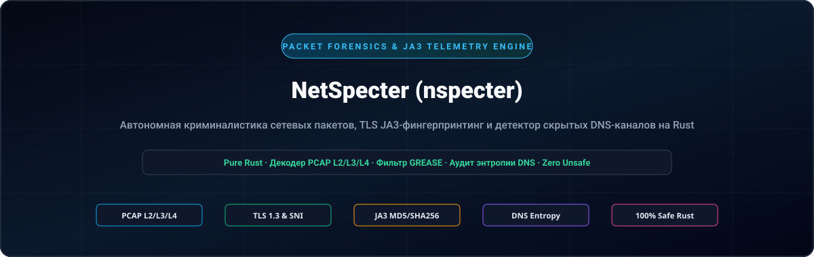
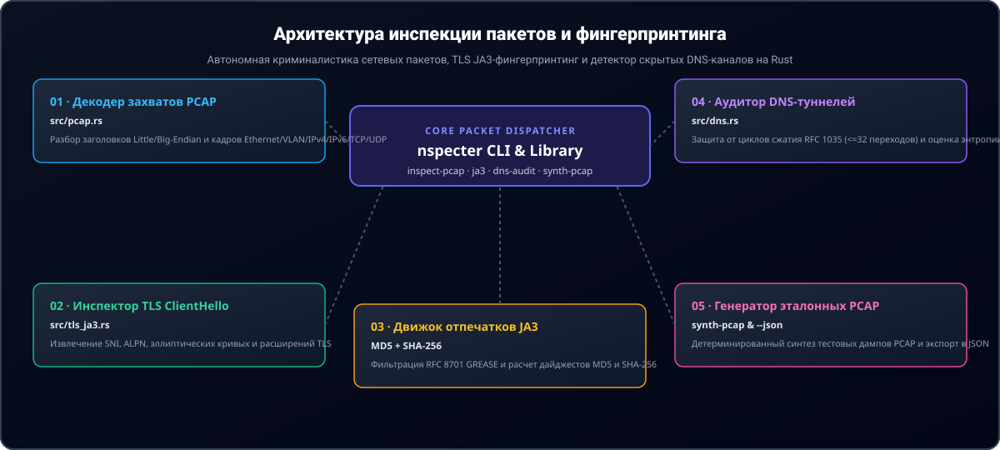

<div align="center">

<p align="center">
  <a href="../../README.md">🇺🇸 English</a> · <a href="./ko.md">🇰🇷 한국어</a> · <a href="./zh-CN.md">🇨🇳 中文</a> · <a href="./es.md">🇪🇸 Español</a> · <a href="./hi.md">🇮🇳 हिन्दी</a><br />
  <a href="./ar.md">🇸🇦 العربية</a> · <a href="./pt-BR.md">🇧🇷 Português</a> · <strong>🇷🇺 Русский</strong> · <a href="./fr.md">🇫🇷 Français</a> · <a href="./id.md">🇮🇩 Bahasa Indonesia</a>
</p>

<p align="center">
  
</p>

# NetSpecter (nspecter)

**Высокоскоростной движок криминалистического анализа сетевых пакетов, фингерпринтинга TLS JA3/JA4 и обнаружения скрытых каналов на чистом Rust без C-зависимостей**

[](https://github.com/GHSFS/net-specter/actions/workflows/ci.yml)
[](../../LICENSE)
[](../../Cargo.toml)
[](../../SECURITY.md)

</div>

---

## 🛡️ Обзор и ключевые возможности

<details open>
<summary><b>🛡️ Обзор и ключевые возможности</b></summary>
<br>

net-specter (nspecter) — это быстрая, безопасная по памяти утилита командной строки и библиотека на чистом Rust, предназначенная для автономного криминалистического анализа сетевых пакетов, фингерпринтинга криптографических рукопожатий и обнаружения скрытых туннелей без использования libpcap или сторонних C-биндингов.

1. **Движок захвата PCAP и PCAPNG без внешних зависимостей (`src/pcap.rs` и `src/pcapng.rs`)** — Декодирует классические файлы libpcap `.pcap` в форматах little-endian и big-endian с микросекундными и наносекундными метками времени (`0xA1B2C3D4`, `0xA1B23C4D`), кадры Ethernet II (со снятием тегов VLAN IEEE 802.1Q), дампы Raw IP (`linktype 101`), заголовки IPv4/IPv6 и транспортные сегменты TCP/UDP; полностью поддерживает блоки секций следующего поколения `.pcapng` (SHB `0x0A0D0D0A`, IDB, EPB и SPB) с произвольной точностью меток времени.
2. **Глубокий инспектор TLS `ClientHello` и движок JA3 (`src/tls_ja3.rs`)** — Выполняет разбор записей рукопожатия TLS (`0x16`) `ClientHello` (`0x01`), извлекает имена хостов SNI (`0x0000`), поддерживаемые эллиптические группы (`0x000a`), форматы точек EC (`0x000b`), протоколы ALPN (`0x0010`) и поддерживаемые версии (`0x002b`); автоматически фильтрует значения GREASE RFC 8701 (`0x?a?a`) и вычисляет хэш-отпечатки **JA3 MD5** и **SHA-256**.
3. **Парсер проводного формата DNS и аудитор скрытых туннелей (`src/dns.rs`)** — Декодирует DNS-пакеты RFC 1035 со строгой защитой от зацикливания сжатых указателей (`<= 32` переходов) и рассчитывает энтропию Шеннона для поддоменов, длину меток и плотность шестнадцатеричной/Base32 нагрузки для выявления каналов C2 и утечки данных (`Low`, `Elevated`, `High`).
4. **Лаборатория детерминированного синтеза пакетов (`nspecter synth-pcap`)** — Генерирует автономные многопакетные дампы `.pcap` и `.pcapng`, содержащие TLS 1.3 `ClientHello` и легитимные/скрытые DNS-запросы для воспроизводимого CI-тестирования и валидации аналитиками.
5. **Современный движок фингерпринтинга TLS / QUIC JA4 и JA4S (`src/ja4.rs`)** — Вычисляет сортированные клиентские отпечатки JA4, совместимые с FoxIO (`t13d1516h2_<cipher_hash>_<ext_hash>`), и серверные отпечатки ответа JA4S, устойчивые к рандомизации порядка расширений TLS в протоколах TCP, QUIC и DTLS.
6. **Реассемблирование TCP-потоков и отслеживание нарушенного порядка сегментов (`src/tcp_stream.rs`)** — Восстанавливает двунаправленные байтовые потоки TCP при фрагментации, повторной передаче и нарушении порядка пакетов с обработкой 32-битного переполнения последовательности RFC 793, защитой памяти от DoS-атак и глубоким анализом прикладных протоколов (TLS JA3/JA4, HTTP/1.1, HTTP/2, SSH).
7. **Инспектор кадров HTTP/1.1 и HTTP/2 и фингерпринтинг JA4H (`src/http_inspect.rs`)** — Разбирает запросы и ответы HTTP/1.1, декодирует преамбулы соединений HTTP/2, потоки бинарных фреймов и параметры `SETTINGS`, рассчитывая клиентские отпечатки `JA4H` по спецификации FoxIO (`nspecter http-audit`).
8. **Криминалистический анализ ServerHello JA3S и цепочек сертификатов X.509 (`src/tls_cert.rs`)** — Извлекает отпечатки ответа сервера JA3S (MD5 и SHA-256 с иммунитетом к GREASE RFC 8701), декодирует сообщения TLS 1.2 и 1.3 `Certificate` (`0x0b`); содержит независимый парсер ASN.1 DER для сертификатов X.509 и выявляет аномалии сертификатов (истекшие, преждевременные, инвертированные даты, слабые алгоритмы подписи, самоподписанные) в дампах PCAP, PCAPNG и собранных TCP-потоках (`nspecter cert-audit`).
9. **Дешифратор начальных пакетов QUIC и RFC 9001 (`src/quic.rs`, `src/quic_crypto.rs`)** — Выводит начальные ключи через HKDF-SHA256, снимает маскировку заголовков RFC 9001, расшифровывает пакеты QUIC Initial с помощью чистого Rust AES-128-GCM, собирает фреймы CRYPTO и извлекает отпечатки TLS 1.3 JA3/JA4 поверх UDP/443 (`nspecter quic-audit`).
10. **Детектор джиттера маяков C2 и спектрограмм периодических интервалов (`src/beacon.rs`)** — Анализирует интервалы прибытия пакетов ($Delta t$), среднее/дисперсию/медиану джиттера, коэффициент вариации ($CV$), спектрограммы частоты интервалов и оценки периодичности для классификации автоматических сигналов C2 (`HighConfidenceBeacon`, `JitteredBeacon`, `SuspectInterval`, `Benign`) в PCAP и PCAPNG (`nspecter beacon-audit`).
11. **Движок выражений фильтрации пакетов в стиле BPF (`src/filter/`)** — Вычисляет фильтры пакетов по диапазонам CIDR IPv4/IPv6, портам, транспортным протоколам, маскам TCP-флагов и размерам кадров (`nspecter filter`).
12. **Фингерпринтинг обмена ключами SSH HASSH для клиентов и серверов (`src/ssh_hassh.rs`)** — Разбирает идентификационные баннеры RFC 4253 и пакеты `SSH_MSG_KEXINIT`, рассчитывая отпечатки Salesforce `HASSH` и `HASSHServer` MD5 и SHA-256 в дампах PCAP, PCAPNG и потоках байтов (`nspecter hassh`).

</details>

---

## 🏛️ Архитектура инспекции пакетов и фингерпринтинга

<details open>
<summary><b>🏛️ Архитектура инспекции пакетов и фингерпринтинга</b></summary>
<br>

<p align="center">
  
</p>

| # | Компонент | Модуль | Основная зона ответственности |
|---|---|---|---|
| **01** | **01 · Проводной декодер PCAP** | `src/pcap.rs` | Парсер микро/наносекундных дампов libpcap little/big-endian и декодирование Ethernet/VLAN/IPv4/IPv6/TCP/UDP |
| **02** | **02 · Инспектор TLS ClientHello** | `src/tls_ja3.rs` | Извлечение без копирования SNI, ALPN, поддерживаемых групп, форматов точек EC и версий |
| **03** | **03 · Криптографический отпечаток JA3** | `MD5 + SHA-256` | Фильтрация GREASE RFC 8701, построение канонических строк JA3 и расчет двойных дайджестов |
| **04** | **04 · Аудитор DNS-туннелей** | `src/dns.rs` | Защита от зацикливания указателей RFC 1035 (<=32 шагов) и оценка C2 по энтропии Шеннона |
| **05** | **05 · Лаборатория синтеза пакетов** | `synth-pcap & --json` | Детерминированная генерация многопакетных дампов PCAP и структурированный вывод телеметрии в JSON |

</details>

---

## 🚀 Быстрый старт и примеры командной строки

<details open>
<summary><b>🚀 Быстрый старт и примеры командной строки</b></summary>
<br>

```bash
# 1. Сборка оптимизированного исполняемого файла
cargo build --release

# 2. Генерация детерминированного тестового дампа в формате .pcap или .pcapng (TLS 1.3 ClientHello + пакеты DNS)
./target/release/nspecter synth-pcap sample.pcap
./target/release/nspecter synth-pcap sample.pcapng --pcapng

# 3. Инспекция всех потоков, TLS JA3 рукопожатий и DNS-запросов в дампе (.pcap или .pcapng)
./target/release/nspecter inspect-pcap sample.pcap
./target/release/nspecter inspect-pcap sample.pcapng --json

# 4. Извлечение деталей TLS ClientHello и хэш-отпечатков JA3 MD5 / SHA-256 из дампа или шестнадцатеричной строки
./target/release/nspecter ja3 sample.pcapng --json

# 5. Извлечение клиентских отпечатков FoxIO JA4 и серверных JA4S из дампа или шестнадцатеричной строки
./target/release/nspecter ja4 sample.pcapng --json

# 6. Аудит пакетов DNS на наличие скрытых туннелей с высокой энтропией и утечки данных C2
./target/release/nspecter dns-audit sample.pcapng --json

# 7. Реассемблирование двунаправленных потоков TCP и инспекция полезной нагрузки приложений
./target/release/nspecter tcp-stream sample.pcapng --json

# 8. Инспекция кадров HTTP/1.1 и HTTP/2 и вычисление клиентских отпечатков HTTP JA4H
./target/release/nspecter http-audit capture.pcap --json

# 9. Криминалистический аудит отпечатков TLS ServerHello JA3S и цепочек сертификатов X.509
./target/release/nspecter cert-audit capture.pcap --json

# 10. Расшифровка начальных пакетов QUIC и извлечение отпечатков TLS 1.3 JA3/JA4
./target/release/nspecter quic-audit capture.pcap --json

# 11. Аудит джиттера маяков C2 и спектрограмм периодических интервалов
./target/release/nspecter beacon-audit capture.pcap --min-events 4 --json

# 12. Фильтрация кадров дампа с использованием выражений в стиле BPF
./target/release/nspecter filter capture.pcap "tcp port 443" --json

# 13. Извлечение баннеров SSH, разбор согласования KEXINIT и расчет отпечатков Salesforce HASSH
./target/release/nspecter hassh capture.pcap --json

# 14. Аудит потоков ICMP Echo Request/Reply на наличие скрытых каналов и подмены полезной нагрузки
./target/release/nspecter icmp-tunnel capture.pcap --dump-payload --json

# 15. Пассивный фингерпринтинг операционных систем по пакетам TCP SYN (p0f v3 и FoxIO JA4T)
./target/release/nspecter os-fp capture.pcap --json

# 16. Аудит запросов и ответов ARP на предмет спуфинга, нелегитимного флуда и аномалий MITM второго уровня
./target/release/nspecter arp-audit capture.pcap --gateway 192.168.1.1 --json
```

</details>

---

## 📦 Справочник модулей и подкоманд

<details open>
<summary><b>📦 Справочник модулей и подкоманд</b></summary>
<br>

```text
net-specter/
├── Cargo.toml                     # Манифест пакета (библиотека net-specter и бинарный файл nspecter)
├── README.md                      # Основная документация на английском языке
├── ROADMAP.md                     # Реализованный функционал и план будущего развития
├── CHANGELOG.md                   # История версий и обновлений
├── SECURITY.md                    # Политика безопасности памяти и сообщения об уязвимостях
├── LICENSE                        # Лицензия Apache-2.0
├── NOTICE                         # Уведомление об авторских правах (GHSFS)
├── src/
│   ├── lib.rs                     # Экспорт публичного интерфейса библиотеки
│   ├── main.rs                    # Главная точка входа CLI (компактный диспетчер <25 строк)
│   ├── cli.rs                     # Определение подкоманд и аргументов Clap
│   ├── error.rs                   # Единая модель ошибок SpecterError и Result<T>
│   ├── commands/                  # Модульные обработчики команд CLI (arp, inspect, tls, dns, tcp, http, cert, quic, synth, beacon, filter, hassh, icmp, os_fp)
│   ├── filter/                    # Парсер рекурсивного спуска и оценщик фильтров в стиле BPF
│   ├── arp_audit.rs               # Детектор ARP-спуфинга RFC 826 / RFC 5227 и атак MITM на уровне L2
│   ├── p0f/                       # Движок пассивного фингерпринтинга ОС и FoxIO JA4T/JA4TS
│   ├── icmp_tunnel.rs             # Детектор скрытых туннелей ICMP Echo и модификации данных
│   ├── beacon.rs                  # Детектор джиттера маяков C2 и спектрограмм интервалов
│   ├── pcap.rs                    # Декодер libpcap .pcap, парсер уровней L2/L3/L4 и генератор
│   ├── pcapng.rs                  # Парсер блоков структуры PCAPNG (SHB/IDB/EPB/SPB) и генератор
│   ├── quic.rs                    # Модуль извлечения пакетов QUIC Initial и потоков CRYPTO
│   ├── quic_crypto.rs             # Дешифратор HKDF-SHA256, AES-128 и GCM на чистом Rust
│   ├── ssh_hassh.rs               # Баннеры SSH-2.0 и движок отпечатков Salesforce HASSH/HASSHServer
│   ├── tls_ja3.rs                 # Парсер TLS ClientHello, фильтр GREASE и движок JA3
│   ├── tls_cert.rs                # Парсер TLS ServerHello JA3S, сертификатов TLS 1.2/1.3 и ASN.1 X.509
│   ├── ja4.rs                     # Современный движок клиентских отпечатков FoxIO JA4 и серверных JA4S
│   ├── tcp_stream.rs              # Сборка TCP-потоков с сохранением состояния и контролем порядка
│   ├── http_inspect.rs            # Анализатор HTTP/1.1, фреймов HTTP/2 SETTINGS и движок отпечатков JA4H
│   └── dns.rs                     # Декодер DNS RFC 1035 и аудитор скрытых туннелей по энтропии Шеннона
└── tests/
    ├── arp_audit_test.rs          # Интеграционные тесты ARP-спуфинга, смены шлюза и аномального флуда
    ├── p0f_test.rs                # Тесты пассивного фингерпринтинга ОС по TCP SYN и FoxIO JA4T
    ├── icmp_tunnel_test.rs        # Тесты скрытых туннелей ICMP и анализа энтропии Шеннона
    ├── beacon_test.rs             # Тесты анализа джиттера маяков C2, спектрограмм и классификации
    ├── filter_test.rs             # Тесты вычисления выражений фильтрации пакетов в стиле BPF
    ├── pcap_tls_test.rs           # Тесты разбора PCAP, L2-L4, фильтрации GREASE и отпечатков JA3
    ├── pcapng_test.rs             # Тесты блоков PCAPNG, наносекундных меток времени и CLI
    ├── ja4_test.rs                # Тесты отпечатков JA4/JA4S, пакетов QUIC Initial и защиты от GREASE
    ├── quic_test.rs               # Тесты вывода ключей HKDF RFC 9001, AES-GCM и дешифровки QUIC
    ├── ssh_hassh_test.rs          # Тесты заголовков SSH, согласования KEXINIT и Salesforce HASSH
    ├── tcp_stream_test.rs         # Тесты сборки TCP-потоков и анализа многосегментного TLS
    ├── http_inspect_test.rs       # Тесты кадров HTTP/1.1, HTTP/2 и фингерпринтинга JA4H
    ├── tls_cert_test.rs           # Тесты ServerHello JA3S, ASN.1 DER X.509 и обнаружения аномалий
    └── dns_audit_test.rs          # Тесты защиты от циклов сжатия DNS и аудита скрытых туннелей
```

Запланированные возможности сетевого анализа и поддержки протоколов приведены в [ROADMAP.md](../../ROADMAP.md).

</details>

---

## 🔒 Безопасность памяти и защита парсеров

<details open>
<summary><b>🔒 Безопасность памяти и защита парсеров</b></summary>
<br>

- **100% безопасный Rust**: Ни единого блока `unsafe` во всех модулях декодирования бинарных фреймов.
- **Защита от циклов сжатия RFC 1035**: Распаковка имен DNS ограничивается строгим лимитом в 32 перехода по указателям с немедленным отклонением прямых и циклических ссылок.
- **Безопасное обнуление временных буферов**: При выходе из области видимости буферы со случайными данными TLS, ID сессий и байтами реассемблирования надежно стираются через `zeroize`.
- **Буферизация сегментов с защитой от DoS**: Очередь неупорядоченных сегментов TCP использует фиксированные квоты памяти на поток, исключая исчерпание ОЗУ при атаках фрагментированным флудом.
- **Политика безопасности и сообщение об уязвимостях**: См. [SECURITY.md](../../SECURITY.md).

</details>

---

## 📄 Лицензия и авторские права

<details open>
<summary><b>📄 Лицензия и авторские права</b></summary>
<br>

```text
Copyright 2026 GHSFS

Licensed under the Apache License, Version 2.0 (the "License");
you may not use this file except in compliance with the License.
You may obtain a copy of the License at

    http://www.apache.org/licenses/LICENSE-2.0
```

</details>
