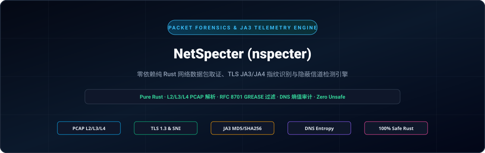
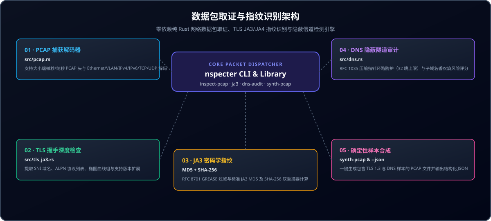

<div align="center">

<p align="center">
  <a href="../../README.md">🇺🇸 English</a> · <a href="./ko.md">🇰🇷 한국어</a> · <strong>🇨🇳 中文</strong> · <a href="./es.md">🇪🇸 Español</a> · <a href="./hi.md">🇮🇳 हिन्दी</a><br />
  <a href="./ar.md">🇸🇦 العربية</a> · <a href="./pt-BR.md">🇧🇷 Português</a> · <a href="./ru.md">🇷🇺 Русский</a> · <a href="./fr.md">🇫🇷 Français</a> · <a href="./id.md">🇮🇩 Bahasa Indonesia</a>
</p>

<p align="center">
  
</p>

# NetSpecter (nspecter)

**零外部 C 依赖的纯 Rust 网络数据包取证、TLS JA3/JA4 指纹提取与隐蔽隧道检测引擎**

[](https://github.com/GHSFS/net-specter/actions/workflows/ci.yml)
[](../../LICENSE)
[](../../Cargo.toml)
[](../../SECURITY.md)

</div>

---

## 🛡️ 项目概述与核心能力

<details open>
<summary><b>🛡️ 项目概述与核心能力</b></summary>
<br>

net-specter (nspecter) 是一款基于纯 Rust 构建的高速、内存安全离线数据包取证工具与库，无需外部 C 库（如 libpcap）即可完成 L2-L7 协议解码、加密握手指纹提取与隐蔽隧道检测。

1. **零外部依赖 PCAP 与 PCAPNG 捕获引擎 (`src/pcap.rs` & `src/pcapng.rs`)** — 支持解码经典 libpcap `.pcap` 文件，兼容小端与大端微秒/纳秒时间戳头部（`0xA1B2C3D4`、`0xA1B23C4D`）、Ethernet II 帧（含 IEEE 802.1Q VLAN 标签剥离）、原始 IP 捕获（`linktype 101`）、IPv4/IPv6 报头及 TCP/UDP 传输层数据段；全面支持下一代 `.pcapng` 分节头部块（SHB，`0x0A0D0D0A`）、接口描述块（IDB）、增强数据包块（EPB）与简单数据包块（SPB），支持任意时间戳精度。
2. **TLS `ClientHello` 深度检测器与 JA3 引擎 (`src/tls_ja3.rs`)** — 精确解析 TLS 握手协议（`0x16`）中的 `ClientHello`（`0x01`）记录，提取 SNI 域名（`0x0000`）、支持的椭圆曲线组（`0x000a`）、EC 点格式（`0x000b`）、ALPN 协议列表（`0x0010`）与支持的版本（`0x002b`）；自动过滤 RFC 8701 GREASE 值（`0x?a?a`），同时计算标准 **JA3 MD5** 与 **SHA-256** 指纹摘要。
3. **DNS 线缆格式解析器与隐蔽隧道审计器 (`src/dns.rs`)** — 严格遵循 RFC 1035 解析 DNS 数据包，配备指针环路防御机制（`<= 32` 跳限制），通过计算子域名香农熵、标签长度与十六进制/Base32 负载密度，识别并标记隐蔽 C2 或数据外发通道（`Low`、`Elevated`、`High`）。
4. **确定性数据包合成实验室 (`nspecter synth-pcap`)** — 生成包含 TLS 1.3 `ClientHello` 与正常/隐蔽 DNS 查询的自包含多数据包 `.pcap` 和 `.pcapng` 样例文件，用于 CI 自动化测试与分析师验证。
5. **JA4 与 JA4S 现代 TLS / QUIC 指纹引擎 (`src/ja4.rs`)** — 在 TCP、QUIC 与 DTLS 传输层上计算符合 FoxIO 规范且排序一致的 JA4 客户端指纹（`t13d1516h2_<cipher_hash>_<ext_hash>`）与 JA4S 服务端响应指纹，抵御 TLS 扩展顺序随机化干扰。
6. **TCP 流重组与乱序数据段追踪器 (`src/tcp_stream.rs`)** — 支持双向 TCP 字节流重组，处理分片、重传与乱序到达，严格遵守 RFC 793 规范的 32 位序列号回绕机制与防 DoS 内存上限，支持对多数据段应用层协议（TLS JA3/JA4、HTTP/1.1、HTTP/2、SSH）进行深度流式分析。
7. **HTTP/1.1 与 HTTP/2 帧检测器及 JA4H 指纹提取 (`src/http_inspect.rs`)** — 解析 HTTP/1.1 请求与响应，解码 HTTP/2 连接前奏、二进制帧流及 `SETTINGS` 参数，计算符合 FoxIO 标准的 `JA4H` 客户端指纹（`nspecter http-audit`）。
8. **TLS ServerHello JA3S 与 X.509 证书链取证 (`src/tls_cert.rs`)** — 提取 JA3S 服务端响应指纹（免疫 RFC 8701 GREASE 的 MD5 与 SHA-256），解码 TLS 1.2 及 TLS 1.3 的 `Certificate`（`0x0b`）消息；内置零依赖 ASN.1 DER 证书解析器（提取使用者/颁发者 DN、有效期时间戳、DNS/IP SAN、序列号、签名算法），并在 PCAP、PCAPNG 及重组 TCP 流中检测证书异常（过期、未生效、反转有效期、弱哈希算法、自签名）（`nspecter cert-audit`）。
9. **QUIC 初始数据包与 RFC 9001 解密器 (`src/quic.rs`, `src/quic_crypto.rs`)** — 通过 HKDF-SHA256 推导初始密钥，解除 RFC 9001 报头掩码保护，使用纯 Rust AES-128-GCM 解密 QUIC Initial 数据包，重组 CRYPTO 帧并从 UDP/443 流量中提取 TLS 1.3 JA3/JA4 指纹（`nspecter quic-audit`）。
10. **C2 信标抖动与周期频谱检测器 (`src/beacon.rs`)** — 深入分析流到达时间差（$Delta t$）、均值/方差/中位数抖动、离散系数（$CV$）、间隔频谱及周期性得分，在 PCAP 和 PCAPNG 中对自动化 C2 心跳流量进行多级分类（`HighConfidenceBeacon`、`JitteredBeacon`、`SuspectInterval`、`Benign`）（`nspecter beacon-audit`）。
11. **BPF 风格数据包过滤表达式引擎 (`src/filter/`)** — 评估针对 IPv4/IPv6 CIDR、端口范围、传输层协议、TCP 标志位掩码及帧长度的过滤表达式（`nspecter filter`）。
12. **SSH HASSH 客户端与服务端密钥交换指纹提取 (`src/ssh_hassh.rs`)** — 解析 RFC 4253 SSH 标识行与 `SSH_MSG_KEXINIT` 数据包，在 PCAP、PCAPNG 及原始流中计算 Salesforce `HASSH` 和 `HASSHServer` 的 MD5 与 SHA-256 指纹（`nspecter hassh`）。

</details>

---

## 🏛️ 数据包取证与指纹分析架构

<details open>
<summary><b>🏛️ 数据包取证与指纹分析架构</b></summary>
<br>

<p align="center">
  
</p>

| # | 核心组件 | 实现模块 | 核心职责 |
|---|---|---|---|
| **01** | **01 · PCAP 线缆解码器** | `src/pcap.rs` | 解析小端/大端微秒及纳秒级 libpcap 数据，解码以太网/VLAN/IPv4/IPv6/TCP/UDP 报头 |
| **02** | **02 · TLS ClientHello 深度分析器** | `src/tls_ja3.rs` | 零拷贝提取 SNI、ALPN、支持的椭圆曲线组、EC 格式及握手协议版本 |
| **03** | **03 · JA3 加密指纹引擎** | `MD5 + SHA-256` | 过滤 RFC 8701 GREASE 值，生成规范 JA3 字符串并计算双重哈希摘要 |
| **04** | **04 · DNS 隐蔽隧道审计器** | `src/dns.rs` | 防御 RFC 1035 指针循环（<=32 跳），基于香农熵评估 C2 异常隐蔽通道 |
| **05** | **05 · 数据包合成实验室** | `synth-pcap & --json` | 确定性生成多数据包 PCAP 样例，提供用于 SIEM 集成的结构化 JSON 遥测输出 |

</details>

---

## 🚀 快速上手与 CLI 命令行用法

<details open>
<summary><b>🚀 快速上手与 CLI 命令行用法</b></summary>
<br>

```bash
# 1. 编译生成发布版二进制程序
cargo build --release

# 2. 生成确定性样例 .pcap 或 .pcapng 捕获文件（包含 TLS 1.3 ClientHello 与 DNS 数据包）
./target/release/nspecter synth-pcap sample.pcap
./target/release/nspecter synth-pcap sample.pcapng --pcapng

# 3. 审查捕获文件（.pcap 或 .pcapng）中的所有网络流、TLS JA3 握手与 DNS 查询
./target/release/nspecter inspect-pcap sample.pcap
./target/release/nspecter inspect-pcap sample.pcapng --json

# 4. 从捕获文件或十六进制字符串中提取 TLS ClientHello 详情及 JA3 MD5 / SHA-256 摘要
./target/release/nspecter ja3 sample.pcapng --json

# 5. 从捕获文件或十六进制字符串中提取 FoxIO JA4 客户端与 JA4S 服务端指纹
./target/release/nspecter ja4 sample.pcapng --json

# 6. 审查 DNS 数据包，检测高熵隐蔽隧道与 C2 数据外发
./target/release/nspecter dns-audit sample.pcapng --json

# 7. 重组双向 TCP 字节流并审查应用层载荷内容
./target/release/nspecter tcp-stream sample.pcapng --json

# 8. 审查 HTTP/1.1 及 HTTP/2 帧并计算 JA4H HTTP 客户端指纹
./target/release/nspecter http-audit capture.pcap --json

# 9. 对 TLS ServerHello JA3S 指纹与 X.509 证书链进行法医级安全审查
./target/release/nspecter cert-audit capture.pcap --json

# 10. 解密 QUIC Initial 数据包并提取 TLS 1.3 JA3/JA4 传输指纹
./target/release/nspecter quic-audit capture.pcap --json

# 11. 审查 C2 信标抖动与周期频谱特征
./target/release/nspecter beacon-audit capture.pcap --min-events 4 --json

# 12. 使用类 BPF 语法表达式过滤捕获的数据帧
./target/release/nspecter filter capture.pcap "tcp port 443" --json

# 13. 提取 SSH 标识头、解析 KEXINIT 协商过程并计算 Salesforce HASSH 指纹
./target/release/nspecter hassh capture.pcap --json

# 14. 审查 ICMP 回显请求/应答流以检测隐蔽通道与载荷篡改
./target/release/nspecter icmp-tunnel capture.pcap --dump-payload --json

# 15. 通过 TCP SYN 数据包被动识别操作系统（p0f v3 与 FoxIO JA4T）
./target/release/nspecter os-fp capture.pcap --json

# 16. 审计 ARP 请求与应答以发现欺骗、无故洪泛与二层中间人攻击异常
./target/release/nspecter arp-audit capture.pcap --gateway 192.168.1.1 --json
```

</details>

---

## 📦 模块与子命令参考指南

<details open>
<summary><b>📦 模块与子命令参考指南</b></summary>
<br>

```text
net-specter/
├── Cargo.toml                     # Crate 包配置清单（定义 net-specter 库与 nspecter 二进制目标）
├── README.md                      # 英文主文档
├── ROADMAP.md                     # 功能演进与未来开发路线图
├── CHANGELOG.md                   # 版本发布历史记录
├── SECURITY.md                    # 内存安全设计与漏洞报告安全策略
├── LICENSE                        # Apache-2.0 许可证
├── NOTICE                         # 版权声明与归属说明 (GHSFS)
├── src/
│   ├── lib.rs                     # 顶层公共库接口导出
│   ├── main.rs                    # CLI 主程序入口（低于 25 行的极简分发器）
│   ├── cli.rs                     # Clap 命令行子命令与参数解析定义
│   ├── error.rs                   # 统一错误模型 SpecterError 与 Result<T>
│   ├── commands/                  # 模块化 CLI 命令处理器（arp, inspect, tls, dns, tcp, http, cert, quic, synth, beacon, filter, hassh, icmp, os_fp）
│   ├── filter/                    # 递归下降 BPF 风格过滤器语法分析与求值引擎
│   ├── arp_audit.rs               # RFC 826 / RFC 5227 ARP 欺骗与二层中间人检测器
│   ├── p0f/                       # 被动操作系统指纹识别与 FoxIO JA4T/JA4TS 引擎
│   ├── icmp_tunnel.rs             # ICMP Echo 隐蔽隧道与载荷篡改检测器
│   ├── beacon.rs                  # C2 信标抖动与时间间隔频谱检测器
│   ├── pcap.rs                    # Libpcap .pcap 解码器、二三四层解析器与发生器
│   ├── pcapng.rs                  # PCAPNG 块结构解析器（SHB/IDB/EPB/SPB）与发生器
│   ├── quic.rs                    # QUIC Initial 数据包解析与 CRYPTO 流提取器
│   ├── quic_crypto.rs             # 纯 Rust 实现的 HKDF-SHA256、AES-128 与 GCM 解密器
│   ├── ssh_hassh.rs               # SSH-2.0 标识头与 Salesforce HASSH/HASSHServer 引擎
│   ├── tls_ja3.rs                 # TLS ClientHello 解析器、GREASE 过滤器与 JA3 引擎
│   ├── tls_cert.rs                # TLS ServerHello JA3S、TLS 1.2/1.3 证书与 X.509 ASN.1 解析器
│   ├── ja4.rs                     # 现代化 FoxIO JA4 客户端与 JA4S 服务端指纹引擎
│   ├── tcp_stream.rs              # 有状态 TCP 字节流重组与乱序段追踪器
│   ├── http_inspect.rs            # HTTP/1.1、HTTP/2 SETTINGS 帧解析与 JA4H 指纹引擎
│   └── dns.rs                     # RFC 1035 DNS 解码器与基于香农熵的隧道审计器
└── tests/
    ├── arp_audit_test.rs          # ARP 欺骗、网关震荡与无故洪泛集成测试
    ├── p0f_test.rs                # TCP SYN 被动操作系统指纹与 FoxIO JA4T 集成测试
    ├── icmp_tunnel_test.rs        # ICMP 隐蔽隧道与香农熵分析集成测试
    ├── beacon_test.rs             # C2 信标抖动、周期频谱与自动分类集成测试
    ├── filter_test.rs             # BPF 风格数据包过滤表达式评估集成测试
    ├── pcap_tls_test.rs           # PCAP、L2-L4 解码、GREASE 过滤与 JA3 集成测试
    ├── pcapng_test.rs             # PCAPNG 块结构、纳秒级时间戳与 CLI 集成测试
    ├── ja4_test.rs                # JA4/JA4S、QUIC Initial 提取与抗扩展乱序集成测试
    ├── quic_test.rs               # RFC 9001 HKDF 密钥推导、AES-GCM 解密与 QUIC 测试
    ├── ssh_hassh_test.rs          # SSH 协议头、KEXINIT 协商与 Salesforce HASSH 集成测试
    ├── tcp_stream_test.rs         # TCP 流重组与跨多段 TLS 负载分析集成测试
    ├── http_inspect_test.rs       # HTTP/1.1、HTTP/2 帧解码与 JA4H 指纹集成测试
    ├── tls_cert_test.rs           # ServerHello JA3S、X.509 ASN.1 DER 解码与异常检测测试
    └── dns_audit_test.rs          # DNS 压缩指针循环防御与隐蔽隧道审计集成测试
```

计划中支持的更多传输层协议与取证特性详见 [ROADMAP.md](../../ROADMAP.md)。

</details>

---

## 🔒 内存安全性与解析器防护设计

<details open>
<summary><b>🔒 内存安全性与解析器防护设计</b></summary>
<br>

- **100% 内存安全 Rust**：所有二进制帧解码模块中绝不使用任何 `unsafe` 代码块。
- **RFC 1035 压缩指针循环防御**：DNS 域名解压缩强制执行不超过 32 跳的指针深度上限，并直接拒绝前向引用及自引用指针。
- **瞬态敏感缓冲区安全置零**：临时存放的 TLS 随机数、会话标识（Session ID）及重组字节缓冲区在析构（Drop）时均通过 `zeroize` 自动擦除。
- **抗 DoS 攻击的数据段缓冲限制**：对乱序到达的 TCP 数据段队列实施严格的单流内存定额管理，防止利用分片泛洪消耗系统内存。
- **安全政策与漏洞提报途径**：详见 [SECURITY.md](../../SECURITY.md)。

</details>

---

## 📄 许可证与版权说明

<details open>
<summary><b>📄 许可证与版权说明</b></summary>
<br>

```text
Copyright 2026 GHSFS

Licensed under the Apache License, Version 2.0 (the "License");
you may not use this file except in compliance with the License.
You may obtain a copy of the License at

    http://www.apache.org/licenses/LICENSE-2.0
```

</details>
